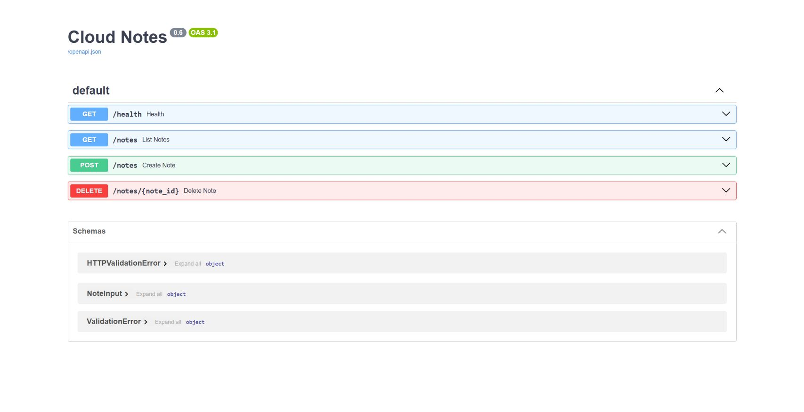

# Modul mahasiswa Lab 06 - Docker Compose lokal

Gunakan **Windows + Docker Desktop + PowerShell**. Modul ini mengikuti lima subtopik praktikum RPS: stack API/DB/cache, DNS service, named volume, .env, serta profile/log streaming.

Latihan formatif untuk proyek kelompok 3 orang; presentasi checkpoint minggu 7 dan hasil akhir minggu 14 mengikuti kebijakan kelas/RPS. Tidak ada penyerahan atau nilai lab tambahan.

Untuk sesi gabungan Core + Compose tanggal 22 Oktober, gunakan [modul gabungan](PRAKTIKUM_GABUNGAN_22_OKTOBER.md) dan [PDF](PRAKTIKUM_GABUNGAN_22_OKTOBER.pdf). Bagian Compose pada modul itu sama dengan urutan di bawah.

## Persiapan

Buka Docker Desktop sampai Engine running. Gunakan PowerShell pada folder kerja baru:

```powershell
git clone https://github.com/SeedFlora/meet6CloudService.git meet6CloudService-local
cd .\meet6CloudService-local
docker version
docker compose version
Copy-Item .\.env.example .\.env
docker compose config --quiet
```

Hasil: Docker menampilkan Client/Server, root berisi compose.yaml, dan konfigurasi valid. Copy .env adalah langkah untuk clone baru. Untuk mengulang pada clone yang sudah benar, gunakan .env yang sudah ada. Tidak ada penyiapan file secret. [Pemakaian volume dari modul lama](MIGRASI_MODUL_LAMA.md).

## 1. Stack API + DB + cache

Buka compose.yaml. Service api dibangun dari api/Dockerfile, db memakai PostgreSQL 16, cache memakai Redis 7. Healthcheck memeriksa kesiapan; depends_on menunggu db/cache sehat sebelum API mulai. Named volume menyimpan data. Network default menghubungkan service. Host Windows memakai API **18006**, sementara port API di dalam container **8000**.

```powershell
docker compose up --build -d --wait
docker compose ps
Invoke-RestMethod http://127.0.0.1:18006/health
```

Hasil: api/db/cache healthy; health memuat status ok, database postgres, cache redis. Buka **http://127.0.0.1:18006/docs** dan pastikan versi aplikasi 0.6. Build pertama memerlukan Internet/download dependency.



*Gambar UI:* tampilan Swagger kode API revisi yang dijalankan melalui Python lokal, untuk mengenali endpoint. Ini bukan bukti container/DB berjalan; gunakan ps dan health untuk memeriksa stack Docker sendiri.

## 2. DNS berdasarkan nama service

```powershell
docker compose exec -T api getent hosts db cache
```

Hasil: db/cache ter-resolve ke IP internal. API menggunakan DB_HOST=db dan hostname cache pada REDIS_URL. localhost dalam container menunjuk container itu sendiri. IP dapat berubah; nama service tetap menjadi alamat yang dipakai aplikasi. DB/cache tidak membuka port ke Windows.

## 3. Data persisten dengan named volume

Di Swagger, buka POST /notes > Try it out, masukkan JSON berikut, lalu Execute:

```json
{"title":"Compose lokal","content":"Catatan di PostgreSQL"}
```

Hasil: HTTP 201, id/title/content/created_at. Jalankan GET /notes. Catat id/title sendiri; ID tidak harus 1.

```powershell
docker compose exec -T db psql -U clouduser -d cloudnotes -c "SELECT id, title FROM notes ORDER BY id;"
docker volume ls --filter name=cloud-notes-lab06
docker compose down
docker compose up -d --wait
Invoke-RestMethod http://127.0.0.1:18006/notes
```

Hasil: id/title sama setelah container diganti. Volume db_data menyimpan file PostgreSQL. down mempertahankan volume. Redis adalah cache, PostgreSQL adalah sumber data.

```powershell
curl.exe -i http://127.0.0.1:18006/notes
curl.exe -i http://127.0.0.1:18006/notes
```

Bandingkan header X-Cache. MISS membaca DB lalu mengisi Redis, HIT membaca cache selama TTL 30 detik. POST catatan baru menghapus cache daftar. GET yang telah dilakukan browser dapat membuat respons pertama langsung HIT.

## 4. Environment dari .env

.env memuat APP_ENV, POSTGRES_DB, POSTGRES_USER, POSTGRES_PASSWORD. compose.yaml mengirim nilai ke DB dan API. File .env diabaikan Git; password contoh hanya untuk laptop latihan. POSTGRES_PASSWORD wajib terisi dan tidak perlu diketik pada perintah terminal.

Buka .env, ubah APP_ENV=classroom menjadi APP_ENV=local-demo, lalu simpan:

```powershell
docker compose up -d --wait api
docker compose exec -T api printenv APP_ENV
```

Hasil: local-demo. Kembalikan APP_ENV=classroom, simpan, lalu ulangi dua perintah tersebut. Hasil kembali classroom. up menerapkan perubahan konfigurasi; restart saja tidak mengubah environment container. Password DB tidak diubah dalam latihan ini.

## 5. Profile dan log streaming

```powershell
docker compose --profile debug up -d adminer
docker compose ps
```

Buka **http://127.0.0.1:18061**. Pilih PostgreSQL; server db, username clouduser, database cloudnotes, password dari POSTGRES_PASSWORD di .env. Pilih tabel notes > Select data. Hasil id/title cocok dengan Swagger. Profile debug menambahkan Adminer sesuai kebutuhan tanpa memasukkannya ke layanan utama.

Buka PowerShell kedua di root repo:

```powershell
docker compose logs -f --tail 20 api
```

Panggil GET /notes melalui Swagger. Request muncul pada log API. Tekan Ctrl+C untuk menghentikan tampilan log; container tetap berjalan.

## Penutupan

```powershell
docker compose --profile debug down
docker compose ps -a
```

Hasil: container project berhenti, volume tetap ada. Untuk melanjutkan, jalankan docker compose up -d --wait.

## Error yang umum

| Gejala | Perbaikan |
|---|---|
| POSTGRES_PASSWORD belum diisi | Salin .env.example ke .env pada clone baru. |
| Masih meminta file secrets | Buka clone/compose.yaml revisi ini. |
| api belum berjalan | Baca docker compose logs --tail 30 db api cache. Selesaikan error dependency dahulu. |
| /health berisi service saja | Gunakan port 18006 dan pastikan versi aplikasi 0.6; respons itu milik Core. |
| Login DB gagal pada volume lama | Gunakan password awal yang sesuai; ikuti panduan migrasi. |
| Port sudah dipakai | Lihat docker ps dan hentikan container latihan sendiri yang memakai port tersebut. |

Rujukan: [Compose quickstart](https://docs.docker.com/compose/gettingstarted/), [networking](https://docs.docker.com/compose/how-tos/networking/), [profiles](https://docs.docker.com/compose/how-tos/profiles/), [.env](https://docs.docker.com/compose/how-tos/environment-variables/variable-interpolation/).
