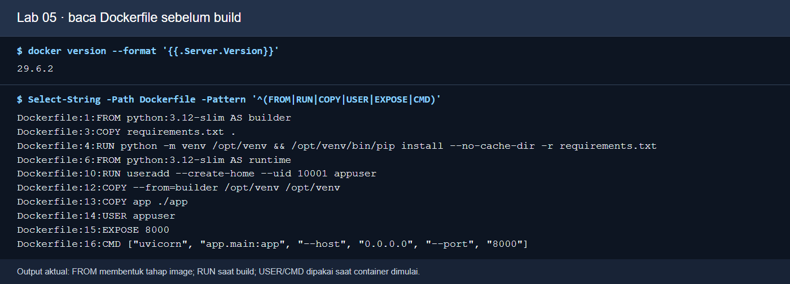
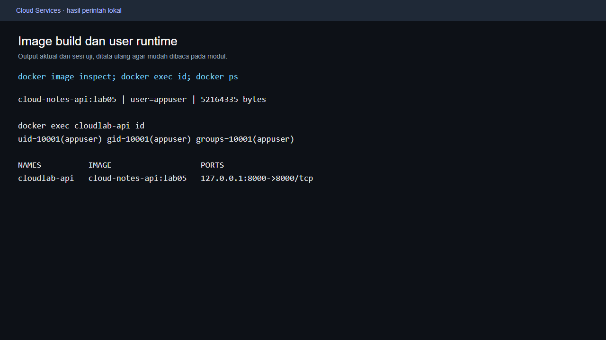
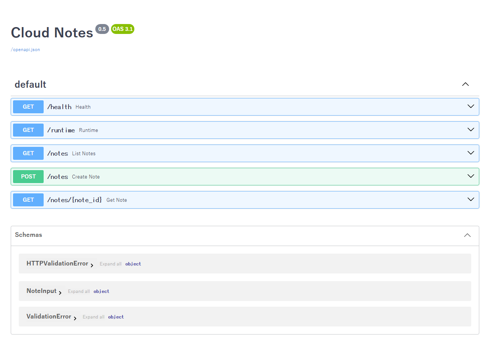
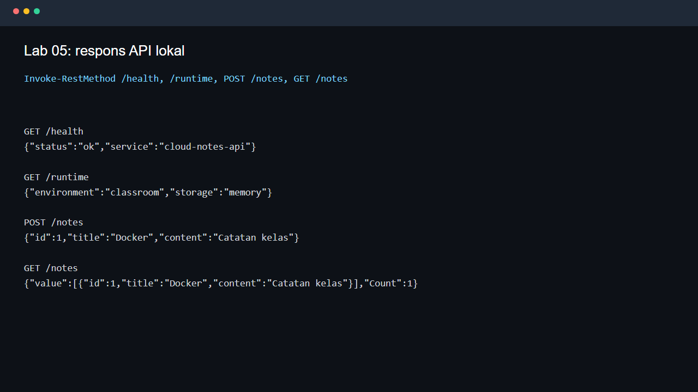
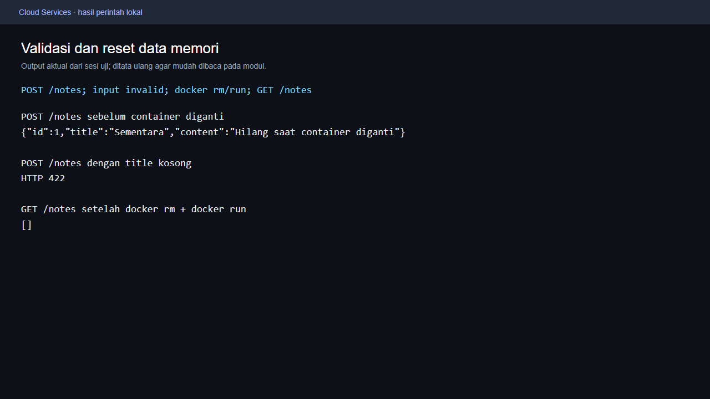

# Praktikum gabungan 22 Oktober 2026: Docker Core dan Docker Compose

**COMP6991031 - Cloud Services | Kamis, 22 Oktober 2026 | Ruang Paskal 0801**

| Kelas | Jam kelas | Durasi |
|---|---|---|
| BA75 | 13:20-15:00 | 100 menit |
| BB75 | 15:20-17:00 | 100 menit |

**Fokus sesi:** menjalankan satu API dalam container, kemudian membandingkannya dengan aplikasi tiga service yang memakai PostgreSQL dan Redis. Seluruh praktik berasal dari **satu clone [meet6CloudService](https://github.com/SeedFlora/meet6CloudService)**. Sesi ini tidak memakai Supabase. Python, PostgreSQL, dan Redis dijalankan dalam container; Python lokal tidak perlu dipasang untuk jalur utama.

**Kebijakan kelas:** latihan ini formatif, tanpa tugas, nilai, atau penyerahan individu/per lab. Satu proyek besar dikerjakan kelompok **3 orang**, dengan presentasi checkpoint minggu 7 (UTS) dan hasil akhir minggu 14 (UAS). Catatan/screenshot hasil sendiri boleh disimpan bila berguna sebagai referensi proyek kelompok. Bobot resmi tetap mengikuti RPS/LMS. Peran kelompok dapat bergantian: operator terminal, pembaca output, dan penjelas alasan.

**Menyalin perintah:** PDF dapat membungkus baris kode yang panjang. Untuk menyalin ke terminal, gunakan blok kode pada [versi Markdown di GitHub](https://github.com/SeedFlora/meet6CloudService/blob/main/PRAKTIKUM_GABUNGAN_22_OKTOBER.md). Pilih blok PowerShell atau Bash sesuai terminal Anda. Bungkus baris visual pada PDF tidak menandakan command baru.

**Cara membaca gambar:** gambar di modul ini adalah bukti materi dari pengujian sebelumnya. Screenshot browser/Docker Desktop menunjukkan antarmuka aktual; kartu terminal menata ulang keluaran command aktual agar mudah dibaca. Gambar Core masih berlabel Lab 05/tag `lab05`/container `cloudlab-api` dan dapat menunjukkan host port **8000**. Untuk sesi gabungan, jalankan command di modul ini dengan tag **`core22`**, container **`cloudlab-core22`**, host port **18005**. Gambar Compose memakai stack Lab 06 pada host port **8000**. Gambar bukan bukti run baru tanggal 22 Oktober; ambil hasil mesin sendiri bila diperlukan untuk proyek. Tanggal, ID, versi patch, dan ukuran image dapat berbeda.

## 1. Persiapan sebelum kelas, di luar 100 menit

Pengunduhan pertama dan build pertama dapat memerlukan waktu lebih lama daripada latihan. Selesaikan bagian ini sebelum kelas agar 100 menit dipakai untuk membaca perilaku sistem. Jika PC kampus dikelola bersama, gunakan akun/folder yang diizinkan pengelola dan minta bantuan pengelola bila instalasi atau Engine belum tersedia.

### 1.1 Periksa alat dan Engine Linux

Buka Docker Desktop dan tunggu Engine siap. Buka **PowerShell biasa** pada Windows, lalu:

```powershell
git --version
docker version
docker compose version
docker info --format '{{.OSType}}'
```

**Fungsi/proses:** Git mengunduh kode; Docker CLI menghubungi daemon; Compose mengelola beberapa service dari YAML. **Hasil yang dibaca:** `docker version` menampilkan **Client dan Server**, Compose menampilkan nomor versi, dan jenis OS adalah **linux**. Client tanpa Server belum membuktikan Engine tersedia. Bila command gagal, selesaikan masalah Engine bersama pengelola; menyalin ulang modul tidak memperbaiki daemon yang mati.

Jalur utama dapat memakai Docker Desktop Windows, Linux/WSL dengan Engine, atau lingkungan kelas lain yang sudah mempunyai Docker. Pada Bash/Linux gunakan blok Bash yang ditandai; pada PowerShell gunakan blok PowerShell. Bila memakai Codespaces, runtime container harus tersedia; browser membuka URL pada tab **Ports** untuk 18005 atau 8000, sedangkan command HTTP dalam terminal tetap memakai `127.0.0.1` di host Codespace. Akses akun Codespaces mengikuti izin/kuota peserta dan bukan prasyarat jalur lokal ini.

### 1.2 Clone satu repo dan kenali root

PowerShell, untuk clone pertama:

```powershell
$folderKelas22 = Join-Path ([Environment]::GetFolderPath('MyDocuments')) 'CloudServices22'
New-Item -ItemType Directory -Path $folderKelas22 -Force | Out-Null
Set-Location -LiteralPath $folderKelas22
git clone https://github.com/SeedFlora/meet6CloudService.git
Set-Location -LiteralPath 'meet6CloudService'
Get-Location
Get-ChildItem -LiteralPath 'compose.yaml', 'api/app/main.py', 'gabungan22/core/Dockerfile', 'gabungan22/core/app/main.py'
git remote -v
```

Bash/Linux, pilih folder pribadi yang dapat ditulis:

```bash
mkdir -p ~/CloudServices22
cd ~/CloudServices22
git clone https://github.com/SeedFlora/meet6CloudService.git
cd meet6CloudService
pwd
ls compose.yaml api/app/main.py gabungan22/core/Dockerfile gabungan22/core/app/main.py
git remote -v
```

**Checkpoint persiapan:** empat file ditemukan. Folder yang langsung berisi `compose.yaml`, `api/`, `secrets/`, dan `gabungan22/` adalah **root repo**. Seluruh command berikut dijalankan dari root itu; tidak perlu clone meet5 atau berpindah ke folder `core`.

Jika repo sudah ada, buka foldernya, jalankan `git status --short` dan `git remote -v`. **Hanya bila status kosong**, gunakan `git pull --ff-only`. Jika ada perubahan latihan, simpan/tinjau dahulu atau gunakan folder baru; jangan reset paksa. Clone publik pengajar cukup untuk praktik lokal; push tidak diperlukan. Origin pengajar bukan tujuan push kontribusi pribadi.

```text
meet6CloudService/                 <- root terminal
  PRAKTIKUM_GABUNGAN_22_OKTOBER.md
  compose.yaml                    <- tahap Compose, API 0.6
  api/app/main.py
  secrets/db_password.txt.example
  .env.example
  gabungan22/
    core/                         <- build context Core, API 0.5
      Dockerfile
      requirements.txt
      .dockerignore
      app/main.py
    screenshots/                  <- gambar acuan Core yang disalin
  screenshots/                    <- gambar acuan Compose
```

### 1.3 Siapkan file lokal tanpa menimpa konfigurasi

PowerShell:

```powershell
if (-not (Test-Path -LiteralPath '.\secrets\db_password.txt')) {
    Copy-Item -LiteralPath '.\secrets\db_password.txt.example' -Destination '.\secrets\db_password.txt'
}
if (-not (Test-Path -LiteralPath '.\.env')) {
    Copy-Item -LiteralPath '.\.env.example' -Destination '.\.env'
}
docker compose config --quiet
git check-ignore -v .env secrets/db_password.txt
```

Bash/Linux:

```bash
if [ ! -e secrets/db_password.txt ]; then
  cp secrets/db_password.txt.example secrets/db_password.txt
fi
if [ ! -e .env ]; then
  cp .env.example .env
fi
docker compose config --quiet
git check-ignore -v .env secrets/db_password.txt
```

**Fungsi/proses:** guard `if` hanya menyalin contoh ketika file tujuan belum ada. Compose membaca file password sebagai secret lokal dan memasangnya pada `/run/secrets/db_password`; `.env` memasok konfigurasi seperti `APP_ENV`. **Hasil:** `config --quiet` keluar tanpa error; Git menunjukkan aturan ignore kedua file. Command tidak mencetak isi password. Jika file sudah ada, tetap dipakai; jangan menggantinya hanya untuk mengikuti contoh. Password contoh adalah data latihan lokal, bukan password akun pribadi.

### 1.4 Unduh dan build sebelum jam kelas

Dari root repo, pada kedua shell:

```bash
docker pull python:3.12-slim
docker compose pull db cache
docker build -t cloud-notes-api:core22 ./gabungan22/core
docker compose build api
docker image ls cloud-notes-api
```

**Fungsi/proses:** base image Python dan image PostgreSQL/Redis disimpan lokal; build memasang dependency API dari internet. Titik terakhir pada build bukan dipakai di sini: context Core disebut lengkap `./gabungan22/core`, sehingga `COPY app ./app` mengambil **kode Core 0.5**. `docker compose build api` mengambil context **`./api`** dari YAML untuk API **0.6**. **Hasil:** image `cloud-notes-api:core22` tersedia dan build Compose berhasil. Build saat kelas mengulang langkah yang sama dan biasanya memakai cache; durasi tetap bergantung mesin.

Clone/pull/build awal memerlukan internet. Setelah image tersedia, jalur localhost tidak memerlukan akun cloud atau layanan berbayar. Jangan menganggap seluruh persiapan bisa dilakukan offline. Bila waktu download belum cukup, dosen/pengelola dapat menyiapkan PC yang image-nya sudah tersedia atau peserta berlatih bergantian pada PC kelompok yang siap.

## 2. Peta 100 menit dan dua tahap aplikasi

| Menit relatif | Kegiatan utama | Hasil yang harus bisa dijelaskan |
|---|---|---|
| 0-5 | Orientasi root, image/container, Dockerfile | Build context dan tanggung jawab runtime. |
| 5-10 | Build cached dan run Core | Tag `core22`, container sendiri, port 18005 -> 8000. |
| 10-21 | Inspect, Swagger, POST/GET, validasi | UID 10001, API 0.5, status 200/201/422. |
| 21-25 | Restart Core dan transisi | Catatan memori hilang; Core dihentikan. |
| 25-35 | Secret, YAML, start Compose | API/db/cache siap melalui healthcheck. |
| 35-45 | DNS, log, health, kontrak API | Nama service internal dan API 0.6. |
| 45-55 | POST/GET, MISS/HIT, invalidasi | Database sumber data; cache TTL 30 detik. |
| 55-70 | Restart API lalu down/up | ID/judul tetap ada pada volume database. |
| 70-75 | Cocokkan checkpoint dan bandingkan data | Core memori; Compose mempertahankan data. |
| 75-85 | Buffer troubleshooting | Tuntaskan checkpoint utama dan pulihkan stack sehat. |
| 85-100 | Refleksi kelompok dan cleanup | Perbandingan dua arsitektur; data volume tetap ada. |

**Total:** Core 25 menit + Compose 60 menit (termasuk buffer troubleshooting 10 menit) + refleksi/cleanup 15 menit. Persiapan, unduhan pertama, build pertama, Adminer, simulasi Redis mati, backup, dan latihan tambahan tidak masuk kewajiban 100 menit utama. Tambahan hanya dicoba sesudah checkpoint utama selesai atau bila dosen menyatakan waktu cukup.

| Aspek | Docker Core: API 0.5 | Docker Compose: API 0.6 |
|---|---|---|
| Lokasi kode | `gabungan22/core/app/main.py` | `api/app/main.py` |
| Cara mulai | `docker run` | `docker compose up` |
| Host API | `127.0.0.1:18005` | `127.0.0.1:8000` |
| Port API dalam container | 8000 | 8000 |
| Penyimpanan | Dictionary pada memori proses API | PostgreSQL pada named volume |
| Cache | Tidak ada | Redis, key `notes:list`, TTL 30 detik |
| `/health` | Proses HTTP API hidup | Koneksi PostgreSQL dan Redis diperiksa |
| Kontrak tambahan | GET `/runtime`, GET `/notes/{note_id}` | DELETE `/notes/{note_id}`; header GET `X-Cache` |

Port host berbeda mencegah dua tahap berebut port. Core tidak otomatis berubah menjadi aplikasi persisten; tahap kedua menjalankan **kode API lain** dengan dependency baru. Data Core tidak dimigrasikan ke database. Pada Compose, database `db:5432` dan cache `cache:6379` tidak dipublish ke host; browser memakai port API host 8000.

## 3. Docker Core, menit 0-25

### A. Baca Dockerfile dan pilih context yang benar

Buka `gabungan22/core/Dockerfile` dan `gabungan22/core/.dockerignore`. Jangan mengedit Dockerfile/Compose root. Perintah berikut sama pada PowerShell/Bash:

```bash
docker build -t cloud-notes-api:core22 ./gabungan22/core
docker image ls cloud-notes-api
```

| Instruksi/command | Fungsi dan proses |
|---|---|
| `FROM python:3.12-slim AS builder` | Memulai tahap pemasangan dependency dari image Python. |
| `COPY requirements.txt .` lalu `RUN ... pip install` | Membaca versi dependency, membuat venv dalam image, dan memasang paket saat **build**. |
| `FROM ... AS runtime` | Memulai tahap akhir yang hanya membawa runtime, venv hasil build, dan kode aplikasi. |
| `COPY --from=builder ...` dan `COPY app ./app` | Menyalin hasil tahap builder dan source dari build context Core. |
| `USER appuser` | Memilih proses non-root; user dibuat dengan UID 10001. |
| `EXPOSE 8000` | Mencatat port aplikasi; tidak otomatis mempublish port host. |
| `CMD ["uvicorn", ...]` | Perintah default ketika container **run**, bukan ketika build. |
| `.dockerignore` | Mengecualikan `.git`, `.venv`, `.env`, dan berkas lain dari context yang dikirim ke builder. |
| `-t cloud-notes-api:core22` | Memberi nama dan tag agar image tahap Core tidak tertukar. |

**Checkpoint Core A:** tag `core22` terdaftar. Image adalah paket filesystem/metadata; container adalah proses dari paket itu. `docker build` belum membuat layanan HTTP yang hidup.

Tag `cloud-notes-api:core22` adalah label image pada mesin ini, bukan bukti image sudah terbit di registry. Tidak perlu membuat akun Docker Hub atau melakukan `docker push` untuk sesi utama.



*Langkah:* baca Dockerfile lalu build dengan context `./gabungan22/core`. *Fungsi:* menemukan tahap build/runtime sebelum run. *Proses:* Docker membaca `FROM`, `RUN`, `COPY`, `USER`, dan `CMD`; source pada folder Core sama dengan materi asal. *Baca hasil:* dua tahap `FROM`, `USER appuser`, dan port container 8000. **Gambar historis Lab 05**, bukan hasil build baru gabungan; gunakan path/context pada blok modul ini.

### B. Run, port, log, user, dan Swagger

Sebelum run, lihat `docker ps -a --filter name=cloudlab-core22`. Jika nama itu sudah ada dari percobaan Anda sebelumnya, ikuti troubleshooting nama container; jangan menghentikan container milik orang lain. Dari root repo:

```bash
docker run --name cloudlab-core22 -d -p 127.0.0.1:18005:8000 -e APP_ENV=classroom cloud-notes-api:core22
docker ps --filter name=cloudlab-core22
docker logs --tail 15 cloudlab-core22
docker exec cloudlab-core22 id
docker image inspect cloud-notes-api:core22 --format '{{.Size}} bytes; user={{.Config.User}}'
```

**Fungsi/proses:** `--name` memberi nama yang bisa dicari; `-d` menjalankan proses di background; `-p 127.0.0.1:18005:8000` mengikat loopback host 18005 ke port container 8000; `-e` memberikan environment saat run. `logs` membaca log proses, `exec ... id` menjalankan pemeriksaan user di container. `image inspect` membaca metadata image, bukan mengubah source.

Tunggu Uvicorn siap, lalu buka **`http://127.0.0.1:18005/docs`** di Chrome. Pada Swagger, temukan label **Cloud Notes 0.5**, GET `/health`, GET `/runtime`, GET/POST `/notes`, dan GET `/notes/{note_id}`. Klik GET `/health` -> **Try it out** -> **Execute**. Ulangi pada GET `/runtime`.

PowerShell:

```powershell
curl.exe -i http://127.0.0.1:18005/health
curl.exe -i http://127.0.0.1:18005/runtime
```

Bash/Linux:

```bash
curl -i http://127.0.0.1:18005/health
curl -i http://127.0.0.1:18005/runtime
```

**Checkpoint Core B:** container Up, log Uvicorn siap, UID **10001**/`appuser`, kedua GET HTTP **200**, runtime `environment=classroom` dan `storage=memory`. `-p` kiri/kanan mempunyai fungsi berbeda. Titik hijau/Up hanya menyatakan proses hidup; request HTTP memberi bukti aplikasi bisa menjawab. `/health` Core tidak memeriksa database karena tahap ini belum punya database.



*Langkah:* jalankan `ps`, `exec ... id`, dan `image inspect` pada container **cloudlab-core22**. *Fungsi:* membuktikan proses dan user runtime. *Proses:* Docker menjalankan image dengan `USER appuser` serta mapping yang diminta. *Baca hasil:* UID 10001 dan nama user. **Gambar historis memakai `cloud-notes-api:lab05`, `cloudlab-api`, host 8000 -> container 8000**; pada sesi ini hasil Anda harus memakai **tag core22, nama cloudlab-core22, host 18005 -> container 8000**. Ukuran image tidak harus sama.



*Langkah:* buka **18005/docs** dan Execute GET health/runtime. *Fungsi:* membaca kontrak sebelum mengirim data. *Proses:* FastAPI menghasilkan OpenAPI dari API 0.5 yang hidup dalam container. *Baca hasil:* versi 0.5, route `/runtime`, dan GET detail catatan. Ini **screenshot browser historis API yang sama**; alamat praktik gabungan adalah port 18005.

### C. Buat, baca, dan tolak input kosong

Pada Swagger, buka POST `/notes`, **Try it out**, lalu isi:

```json
{"title":"Core22","content":"Data ini hanya di memori proses"}
```

Klik **Execute**, baca **HTTP 201**, dan perhatikan `id`. Lanjutkan GET `/notes` -> Execute; catatan yang sama muncul. Ulangi POST dengan title hanya spasi:

```json
{"title":"   ","content":"uji validasi"}
```

**Hasil yang diharapkan:** HTTP **422**. Aplikasi memang menolak input, bukan crash. Jumlah catatan tidak bertambah.

Alternatif terminal PowerShell:

```powershell
$responsCore22 = Invoke-WebRequest http://127.0.0.1:18005/notes -Method Post -ContentType application/json -Body '{"title":"Core22","content":"Data ini hanya di memori proses"}' -UseBasicParsing
$responsCore22.StatusCode
$responsCore22.Content
curl.exe -i http://127.0.0.1:18005/notes
try {
    Invoke-WebRequest http://127.0.0.1:18005/notes -Method Post -ContentType application/json -Body '{"title":"   ","content":"uji validasi"}' -UseBasicParsing
} catch { [int]$_.Exception.Response.StatusCode }
```

Alternatif Bash/Linux:

```bash
curl -i http://127.0.0.1:18005/notes -H 'Content-Type: application/json' -d '{"title":"Core22","content":"Data ini hanya di memori proses"}'
curl -i http://127.0.0.1:18005/notes
curl -i http://127.0.0.1:18005/notes -H 'Content-Type: application/json' -d '{"title":"   ","content":"uji validasi"}'
```

**Fungsi/proses:** POST mengirim JSON; Pydantic memeriksa panjang serta memangkas spasi; input valid disimpan dalam dictionary dengan lock, kemudian GET membaca dictionary yang sama. **Checkpoint Core C:** status 201/200/422 dan judul `Core22` terlihat. Jangan menyalin ID contoh dari screenshot; baca ID hasil mesin sendiri. Jika mencoba Swagger dan terminal sekaligus, akan ada lebih dari satu catatan karena keduanya mengirim POST.



*Langkah:* GET health/runtime, POST valid, lalu GET daftar melalui **18005**. *Fungsi:* membuktikan jalur request sampai penyimpanan memori. *Proses:* satu proses API menyimpan dan membaca dictionary. *Baca hasil:* status sehat, `storage=memory`, judul dan ID yang sama. **Gambar historis Lab 05**; bagian GET menampilkan bentuk objek hasil penyajian PowerShell (`value`/`Count`), sedangkan body HTTP asli GET `/notes` adalah JSON array seperti `[... ]`.

### D. Restart proses dan buktikan data memori hilang

Command berikut me-restart **hanya container Core yang dibuat pada bagian B**. Objek/ID container dan image tetap sama, tetapi proses API dihentikan lalu dimulai lagi. Tidak ada database/volume Core yang menyimpan catatan.

```bash
docker restart cloudlab-core22
docker ps --filter name=cloudlab-core22
docker logs --tail 10 cloudlab-core22
```

Tunggu proses siap; GET `/notes` pada Swagger atau PowerShell `curl.exe -i http://127.0.0.1:18005/notes` / Bash `curl -i http://127.0.0.1:18005/notes`. **Checkpoint Core D:** HTTP 200 dan daftar **`[]`**. Source image dan ID container tidak berubah, tetapi proses yang dimulai ulang mempunyai dictionary kosong. Image menyimpan kode/dependency, bukan catatan pada memori proses yang sudah berakhir.



*Langkah sesi utama:* POST input invalid, `docker restart cloudlab-core22`, lalu GET daftar di **18005**. *Fungsi:* membedakan validasi dan hilangnya penyimpanan sementara. *Proses:* input blank ditolak; proses yang dimulai ulang mempunyai state memori kosong. *Baca hasil:* 422 untuk title kosong/spasi, lalu `[]`. **Gambar historis Lab 05 menunjukkan `rm`/`run`, bukan command restart sesi ini**; keduanya memulai proses API baru dan menghilangkan dictionary memori. Nama/port gambar adalah contoh asal, bukan bukti run baru tanggal 22 Oktober.

Selesaikan Core dan kembali ke fokus Compose. Terminal tetap berada di root repo:

```bash
docker stop cloudlab-core22
docker rm cloudlab-core22
```

`stop` menghentikan proses, `rm` menghapus objek container. Image bertag `core22` tetap tersedia untuk membuka ulang latihan. Jangan mengganti command ini dengan penghapusan semua container pada PC.

## 4. Docker Compose, menit 25-85

### E. Baca YAML, validasi, lalu start tiga service

Buka `compose.yaml` pada root repo. Cocokkan tiga service utama:

| Bagian YAML | Fungsi pada aplikasi |
|---|---|
| `api`, build `./api` | API **0.6** menghubungkan PostgreSQL dan Redis; berbeda dari Core 0.5. |
| `db`, image `postgres:16-alpine` | Menyimpan catatan di database `cloudnotes`. |
| `cache`, image `redis:7-alpine` | Menyimpan salinan daftar catatan sementara. |
| `DB_HOST: db`, `REDIS_URL: redis://cache:6379/0` | API mengakses nama service pada network Compose. |
| `127.0.0.1:8000:8000` | Browser host mengakses API melalui port host 8000. |
| `depends_on ... service_healthy` | API menunggu healthcheck database/cache saat startup. |
| `db_data`, `redis_data` | Named volume memisahkan penyimpanan data dari umur container. |
| `POSTGRES_PASSWORD_FILE` dan `secrets` | Password dibaca dari file lokal yang dipasang sebagai secret. |

Ulangi guard penyiapan `.env` dan file password pada bagian **1.3**; guard aman dijalankan ulang karena tidak menimpa file yang sudah ada. Kemudian:

```bash
docker compose config --quiet
docker compose up --build -d --wait
docker compose ps
```

**Fungsi/proses:** `config --quiet` memvalidasi model Compose tanpa mencetak konfigurasi/password; `up --build` memastikan image API memakai context `./api`; `-d` melepas terminal; `--wait` menunggu service running/healthy. **Checkpoint Compose E:** `api`, `db`, dan `cache` sehat. Jika masih `starting`, tunggu dan periksa log; jangan melanjutkan ke percobaan cache saat database belum siap. First build seharusnya sudah dilakukan sebelum kelas.


*Langkah:* guard file lokal, `config --quiet`, dan `git check-ignore`. *Fungsi:* mempersiapkan stack tanpa mempublikasikan password. *Proses:* Compose membaca YAML/secret, sedangkan Git mengabaikan file nyata. *Baca hasil:* file tersedia, exit 0, dan dua aturan ignore. Kartu ini merupakan **keluaran pengujian historis yang ditata ulang**; tidak menampilkan nilai password.


*Langkah:* `docker compose up --build -d --wait` dan `ps`. *Fungsi:* mengonfirmasi startup. *Proses:* Compose membuat network/volume serta menunggu healthcheck. *Baca hasil:* API/db/cache healthy dan host API 8000. **Gambar historis Lab 06**; nama project dan ID pada mesin peserta dapat berbeda. Healthcheck startup bukan jaminan seluruh dependency akan sehat selamanya.

### F. DNS, log, health dependency, dan Swagger 0.6

```bash
docker compose exec -T api getent hosts db cache
docker compose logs --tail 10 api db cache
```

PowerShell:

```powershell
curl.exe -i http://127.0.0.1:8000/health
```

Bash/Linux:

```bash
curl -i http://127.0.0.1:8000/health
```

**Fungsi/proses:** DNS internal Compose menerjemahkan `db` dan `cache` menjadi IP container. `127.0.0.1` di host adalah host, sedangkan di container adalah container tersebut; API tidak memakai `localhost` untuk mencari database tetangga. `/health` API 0.6 melakukan query PostgreSQL dan ping Redis sebelum mengirim JSON. **Checkpoint Compose F:** dua hostname ter-resolve, GET HTTP **200**, JSON `status=ok`, `database=postgres`, `cache=redis`. IP dapat berubah setelah stack dibuat ulang, tetapi nama service tetap dipakai kode.


*Langkah:* `getent hosts db cache`, `logs`, GET `/health` port 8000. *Fungsi:* memisahkan diagnosis DNS/proses dari status HTTP. *Proses:* nama service di-resolve pada network yang sama, kemudian API menguji dependency. *Baca hasil:* dua alamat internal, log tiap service, dan respons health 200. **Kartu keluaran historis**, IP/jam bukan nilai yang harus disalin.

Buka **`http://127.0.0.1:8000/docs`** di Chrome. Cari label **0.6**. Route `/runtime` Core tidak tersedia pada versi ini; GET `/notes/{note_id}` Core juga tidak tersedia. Versi Compose menyediakan **DELETE `/notes/{note_id}`**. Dalam 100 menit utama, cukup gunakan GET/POST daftar; jangan menghapus catatan kelompok lain pada stack bersama.


*Langkah:* buka **8000/docs** setelah semua service sehat. *Fungsi:* membaca kontrak tahap Compose. *Proses:* Swagger berasal dari API 0.6 di context `api/`. *Baca hasil:* `/health`, GET/POST `/notes`, dan DELETE catatan; bandingkan dengan Swagger 0.5 pada Core. Ini **screenshot browser historis**, bukan bukti container Core mendapat database secara otomatis.

### G. Catatan persisten, MISS/HIT, dan invalidasi

PowerShell:

```powershell
$catatanCompose22 = Invoke-RestMethod http://127.0.0.1:8000/notes -Method Post -ContentType application/json -Body '{"title":"Compose22","content":"Catatan ini disimpan di PostgreSQL"}'
$catatanCompose22
$bacaPertama22 = Invoke-WebRequest http://127.0.0.1:8000/notes -UseBasicParsing
$bacaPertama22.Headers['X-Cache']
$bacaPertama22.Content
$bacaKedua22 = Invoke-WebRequest http://127.0.0.1:8000/notes -UseBasicParsing
$bacaKedua22.Headers['X-Cache']
```

Bash/Linux:

```bash
curl -i http://127.0.0.1:8000/notes -H 'Content-Type: application/json' -d '{"title":"Compose22","content":"Catatan ini disimpan di PostgreSQL"}'
curl -i http://127.0.0.1:8000/notes
curl -i http://127.0.0.1:8000/notes
```

**Fungsi/proses:** POST memasukkan baris PostgreSQL dan menghapus cache `notes:list`. GET pertama membaca database dan mengisi Redis selama **30 detik**; GET berikutnya mengambil salinan cache bila TTL belum habis. **Checkpoint Compose G:** POST **201**, respons berisi `id`, `title`, `content`, `created_at`; dua GET berurutan memperlihatkan **MISS lalu HIT**. GET daftar diurutkan ID menurun. Jika ada GET dari browser/anggota kelompok di antara percobaan, ia dapat lebih dahulu mengisi cache, sehingga GET terminal pertama terlihat HIT. Ini bukan kegagalan database.

Untuk urutan yang mudah diulang, POST catatan baru berjudul `Compose22-baru`, lalu segera lakukan dua GET tanpa refresh browser di antaranya. Jika lebih dari 30 detik berlalu, cache dapat kedaluwarsa dan GET menjadi MISS lagi. POST yang invalid tidak memasukkan baris baru. Gunakan Swagger atau blok validasi Core dengan URL diganti menjadi port **8000** untuk memastikan title spasi tetap menghasilkan **422**.


*Langkah:* POST valid, lalu dua GET daftar segera. *Fungsi:* mengamati salinan cache dan sumber database. *Proses:* PostgreSQL menyimpan catatan; Redis menahan JSON daftar dengan TTL 30 detik. *Baca hasil:* header `X-Cache: MISS` lalu `HIT`, ID/judul tetap sama. **Gambar historis Lab 06**; pada sesi ini gunakan judul sendiri dan baca `created_at`/ID hasil sendiri.

Catat **satu ID dan judul** hasil POST untuk langkah persistensi. Tidak perlu mengumpulkan laporan; angka ini dipakai kelompok untuk membandingkan hasil sebelum/sesudah.

### H. Buktikan persistensi saat API dan stack dibuat ulang

Perintah berikut sama pada PowerShell/Bash. Query SQL hanya membaca data:

```bash
docker compose exec -T db psql -U clouduser -d cloudnotes -c "SELECT id, title FROM notes ORDER BY id DESC LIMIT 5;"
docker compose restart api
docker compose up -d --wait
docker compose ps
```

Ulangi GET `/notes` dari browser/terminal setelah API sehat. **Checkpoint H1:** ID/judul catatan `Compose22` masih ada. Restart proses API tidak menghapus data PostgreSQL. Nama service yang direstart `api`, bukan semua proses pada PC.

Sekarang hentikan dan buat ulang stack, tanpa menghapus volume:

```bash
docker compose --profile debug down
docker compose up -d --wait
docker compose exec -T db psql -U clouduser -d cloudnotes -c "SELECT id, title FROM notes ORDER BY id DESC LIMIT 5;"
```

Ulangi GET `/notes`. **Checkpoint H2:** ID/judul catatan dummy yang **Anda buat** masih ada sesudah down/up. Volume `db_data` dipasang kembali ke database. Database dapat sudah berisi catatan dari latihan sebelumnya; jangan mengharuskan jumlah awal nol atau ID pertama 1. Nama aktual volume umumnya diberi prefix project; jangan menganggap setiap repo menggunakan volume yang sama. `down` melepas container/network; **tidak** menghapus named volume bila tidak ada `-v`.


*Langkah:* query SQL, restart API, down/up **tanpa `-v`**, query ulang. *Fungsi:* membuktikan umur data lebih panjang daripada umur container API/stack. *Proses:* PostgreSQL menulis ke named volume, lalu membaca volume yang sama ketika container baru berjalan. *Baca hasil:* cocokkan ID/judul sebelum dan sesudah. **Kartu pengujian historis**, bukan instruksi memakai ID yang tercetak. Jangan menjalankan `down -v` untuk latihan utama.

## 5. Refleksi dan cleanup, menit 85-100

Diskusikan enam pertanyaan berikut dalam kelompok; jawab lisan dengan menunjuk output praktik. Screenshot/catatan pribadi bersifat opsional untuk proses proyek.

1. Mengapa image/ID container Core tetap sama tetapi catatannya hilang setelah restart proses?
2. Apa beda host 18005/container 8000 pada Core, dan host 8000/container 8000 pada Compose?
3. Mengapa API Compose memakai hostname `db` dan `cache`, sedangkan browser memakai `127.0.0.1`?
4. Apa arti MISS/HIT, mengapa POST menginvalidasi daftar, dan mengapa dua GET terpisah lebih dari 30 detik dapat sama-sama MISS?
5. Mengapa data Compose bertahan setelah restart API/down-up? Jika membahas tambahan Redis mati, mengapa health dapat 503 tetapi GET daftar tetap 200?
6. Apa yang dihapus oleh `docker rm`, `docker compose down`, dan `docker compose down -v`? Mana yang dipakai pada sesi ini?

**Kunci refleksi lengkap:**

1. Image memuat kode/dependency/metadata, sedangkan dictionary catatan berada pada memori proses. Proses baru memulai dictionary kosong; tidak ada database/volume Core yang menyimpan catatan.
2. Angka kiri adalah port host yang dibuka browser; angka kanan port aplikasi di container. Core memakai host 18005 agar tidak bentrok dengan Compose host 8000. Keduanya menjalankan API pada port container 8000.
3. DNS Compose mengetahui nama service pada network internal. `localhost` di container API menunjuk API itu sendiri, bukan database. Browser host masuk melalui API yang dipublish; database dan Redis tetap internal.
4. MISS membaca sumber PostgreSQL lalu menyimpan salinan Redis; HIT mengambil salinan itu. POST mengubah sumber data sehingga cache lama harus dibuang. TTL 30 detik membuat salinan kedaluwarsa, dan GET lain/anggota kelompok dapat mengisi cache di antara percobaan.
5. PostgreSQL menyimpan catatan pada named volume, sehingga proses/API container baru tetap memakai data yang sama. PostgreSQL adalah sumber kebenaran; Redis hanya mempercepat baca. Pada skenario tambahan, health memeriksa kedua dependency sehingga Redis mati menghasilkan 503, tetapi handler GET menangkap gangguan Redis dan membaca PostgreSQL untuk menjawab 200/MISS.
6. `docker rm` menghapus objek container yang dipilih; pada Core proses memori telah berakhir. `compose down` menghentikan/menghapus container dan network stack, mempertahankan named volume. Tambahan `-v` menghapus named volume/data latihan. **Sesi utama memakai down tanpa `-v`.**

Setelah semua kelompok selesai mengamati, lakukan cleanup berikut. Jika skenario tambahan Redis sempat dicoba, pulihkan cache dahulu agar percobaan berikut dimulai dari keadaan yang jelas:

```bash
docker compose --profile debug down
docker compose ps -a
docker ps -a --filter name=cloudlab-core22
```

**Hasil akhir:** container stack berhenti; Core sudah di-stop/remove pada bagian D; image dan named volume tetap tersimpan. Bila Core masih tercantum dan memang container yang Anda buat, stop/remove hanya `cloudlab-core22`. Jangan menghapus semua container atau volume PC. Data Compose dapat dibuka lagi dengan `docker compose up -d --wait` pada repo/project yang sama.

**Bukti latihan yang boleh disimpan:** tag/UID Core, Swagger 0.5 dan 0.6, status 201/422, Core daftar kosong sesudah restart, Compose MISS/HIT, dan ID dummy tetap ada sesudah restart/down-up. Bukti tambahan hanya bila dicoba, seperti health 503 -> 200 saat Redis dipulihkan. Tidak ada kewajiban laporan, repo pribadi, commit, atau push per lab.

## 6. Troubleshooting cepat dan kunci checkpoint

| Gejala | Pemeriksaan, alasan, dan tindakan |
|---|---|
| Docker hanya menampilkan Client | Daemon belum siap. Buka Docker Desktop, tunggu Engine Linux, periksa `docker version`. Pengelola menangani izin/virtualisasi PC; jangan melanjutkan build saat Server tidak tersedia. |
| `COPY app` gagal atau API Core justru 0.6 | Periksa root dan context. Core: `docker build ... ./gabungan22/core`; Compose: context `./api` dari `compose.yaml`. Jangan memakai root sebagai context Core. |
| Nama `cloudlab-core22` sudah dipakai | Periksa `docker ps -a --filter name=cloudlab-core22` dan `docker inspect cloudlab-core22 --format '{{.Config.Image}}'`. Jika itu percobaan **milik Anda** dengan image `cloud-notes-api:core22`, stop/remove nama tersebut lalu run lagi. Jika milik sesi lain, minta koordinasi; jangan force-remove secara acak. |
| Port 18005/8000 sudah dipakai | Lihat mapping `docker ps`. Hentikan hanya layanan praktik sendiri bila sudah selesai. Jangan mematikan layanan orang lain. Core dan Compose memang memakai host port berbeda; periksa salah ketik angka kiri. |
| Swagger tidak terbuka sesudah run | Tunggu log Uvicorn, periksa container Up, lalu GET health. Di Codespaces buka URL tab Ports; localhost laptop berbeda dari localhost Codespace. |
| Core runtime/daftar salah | Pastikan browser masih port **18005**, label Swagger **0.5**, dan container/tag benar. `/runtime` bukan endpoint API Compose 0.6. |
| Compose secret file tidak ada | Jalankan guard bagian 1.3 dari root. Jangan mengganti file password yang sudah ada, menaruh password pada command, atau memotret isi file. |
| DB unhealthy atau login gagal setelah password diubah | Named volume lama mempertahankan database/password yang dibuat sebelumnya. Mengubah file secret saja tidak mengganti password database yang sudah diinisialisasi. Gunakan konfigurasi lokal yang cocok atau minta bantuan dosen; jangan hapus volume yang datanya masih diperlukan. |
| GET pertama sudah HIT | Browser/anggota kelompok mungkin sudah membaca atau cache belum kedaluwarsa. POST judul baru, lalu dua GET segera; tunggu TTL bila perlu. Jangan menganggap ID harus mulai dari 1 bila volume sebelumnya ada. |
| Catatan hilang setelah eksperimen | Pastikan melihat port tahap yang benar; Core memang memori. Untuk Compose, periksa project/root yang sama dan bahwa tidak pernah memakai `down -v`. |
| API unhealthy saat cache berhenti | Health Compose mewajibkan DB+Redis sehat. Cek GET `/notes` untuk melihat fallback, lalu `start cache` dan `up -d --wait` agar semua sehat lagi. |

| Checkpoint | Kunci hasil |
|---|---|
| Core A | Image `cloud-notes-api:core22` tersedia; build bukan layanan hidup. |
| Core B | Container `cloudlab-core22`, host 18005 -> container 8000, UID 10001, HTTP 200, API 0.5, storage memory. |
| Core C | POST 201, GET 200, input blank/spasi 422, tidak ada baris invalid. |
| Core D | Setelah restart proses, GET 200 dengan `[]`; image dan ID container sama. |
| Compose E/F | API/db/cache healthy; nama db/cache ter-resolve; health 200 memeriksa dependency; API 0.6. |
| Compose G | Catatan mempunyai created_at; GET MISS/HIT dalam TTL; POST invalidasi. |
| Compose H | ID/judul sama sesudah restart API dan down/up tanpa -v. |
| Tambahan insiden Redis | Redis mati: health 503, notes 200/MISS; Redis pulih: health 200, data tetap ada. Bukan checkpoint wajib 100 menit. |

## 7. Tambahan di luar 100 menit

### Adminer melalui profile debug

Ini alternatif inspeksi SQL visual, bukan pengganti bukti query/persistensi di tahap utama:

```bash
docker compose --profile debug up -d adminer
```

Buka `http://127.0.0.1:8081`, pilih PostgreSQL, server `db`, user `clouduser`, database `cloudnotes`, dan password dari file lokal. Pilih tabel `notes` -> Select data. Cocokkan ID/judul dengan GET API. Jangan menggunakan Drop/Truncate atau memotret password. Cleanup tetap `docker compose --profile debug down` tanpa `-v`.


*Langkah:* start profile debug, login lokal, pilih Select data tabel notes. *Fungsi:* menghubungkan respons API dengan baris SQL melalui UI. *Proses:* Adminer mengakses PostgreSQL di network yang sama. *Baca hasil:* nama database, ID, dan judul yang cocok. Ini **screenshot browser historis**; bagian tambahan ini berada di luar 100 menit utama.

### Insiden Redis: tambahan sesudah checkpoint utama atau bila waktu cukup

Bagian ini bukan checkpoint wajib pada 100 menit utama. Kerjakan hanya sesudah checkpoint utama selesai atau bila dosen menyatakan waktu cukup, pada stack praktik kelompok sendiri. Pastikan sudah ada catatan dan database sehat; kemudian:

```bash
docker compose stop cache
docker compose ps -a
```

PowerShell:

```powershell
try {
    Invoke-WebRequest http://127.0.0.1:8000/health -UseBasicParsing
} catch { [int]$_.Exception.Response.StatusCode }
$tanpaCache22 = Invoke-WebRequest http://127.0.0.1:8000/notes -UseBasicParsing
$tanpaCache22.StatusCode
$tanpaCache22.Headers['X-Cache']
$tanpaCache22.Content
```

Bash/Linux:

```bash
curl -i http://127.0.0.1:8000/health
curl -i http://127.0.0.1:8000/notes
```

**Checkpoint tambahan I1:** `/health` **503** karena kontrak health mewajibkan database dan cache sehat; GET `/notes` tetap **200**, `X-Cache: MISS`, dan catatan lama masih ada karena handler membaca PostgreSQL ketika Redis gagal. Request bisa lebih lambat karena menunggu timeout Redis. `ps` dapat menandai API unhealthy setelah healthcheck berikutnya, walaupun handler daftar masih menjawab. Status health yang ketat dan fallback fitur adalah dua keputusan desain yang harus dijelaskan.

**Proses:** kegagalan Redis ditangkap sebagai `RedisError`; API melewati cache dan membaca sumber kebenaran di database. `depends_on` mengatur kesiapan startup, bukan menjamin dependency tidak akan mati atau otomatis memulihkan Redis. Jangan berhenti pada kesimpulan "Docker rusak" tanpa membaca service dan endpoint yang gagal.

Pulihkan:

```bash
docker compose start cache
docker compose up -d --wait
docker compose ps
```

Ulangi GET health dan dua GET daftar. **Checkpoint tambahan I2:** health kembali **200**; catatan tetap ada; daftar dapat kembali MISS/HIT. Bila Redis AOF mempertahankan key yang belum kedaluwarsa, GET pertama setelah pulih dapat HIT. Untuk urutan MISS/HIT yang pasti mudah diamati, POST catatan baru yang aman terlebih dahulu, kemudian dua GET cepat; POST menginvalidasi cache daftar.


*Langkah:* stop cache, GET health/notes, start cache, tunggu sehat, lalu periksa kembali data. *Fungsi:* membedakan health dependency, kemampuan fallback, dan keselamatan data. *Proses:* Redis berhenti, API membaca PostgreSQL langsung; setelah cache pulih, health dan cache path dapat bekerja lagi. *Baca hasil:* health 503, notes 200/MISS, pulih, ID catatan tetap ada. **Transkrip pengujian historis yang ditata ulang**, bukan bukti outage baru di PC peserta.

### Backup dan restore sebagai bacaan lanjut

Backup/restore tidak dikerjakan dalam 100 menit utama. Bila ingin memperluas praktik, ikuti [bagian 10 panduan teori: backup logis dan restore ke database uji baru](TEORI_LANGKAH_DEMI_LANGKAH.md#10-backup-logis-dan-restore-ke-database-uji-baru). Panduan tersebut memakai data dummy dan database tujuan baru, mempertahankan data sumber, serta menyimpan arsip lokal yang diabaikan Git. Membuat file dump saja belum membuktikan restore berhasil; periksa hasil pada database uji sesuai panduan. Tidak ada kewajiban tambahan atau command penghapusan volume pada sesi ini.

## Rujukan dan asal kode/gambar

- [Docker build](https://docs.docker.com/reference/cli/docker/buildx/build/), [Docker run](https://docs.docker.com/reference/cli/docker/container/run/), [Dockerfile](https://docs.docker.com/reference/dockerfile/).
- [Compose startup order](https://docs.docker.com/compose/how-tos/startup-order/), [Compose networking](https://docs.docker.com/compose/how-tos/networking/), [Compose volumes](https://docs.docker.com/reference/compose-file/volumes/), [Compose secrets](https://docs.docker.com/compose/how-tos/use-secrets/).
- [API Core asal Lab 05](https://github.com/SeedFlora/meet5CloudService): Dockerfile, requirements, .dockerignore, source app, dan lisensi disalin tanpa perubahan ke [gabungan22/core](gabungan22/core/README.md); lisensi MIT asli tetap tersedia. [Sumber gambar Core](gabungan22/screenshots/SUMBER_GAMBAR.md) menjelaskan seluruh salinan dan port historis.
- API Compose memakai source Lab 06 yang sudah tersedia pada [api/app/main.py](api/app/main.py) dan [compose.yaml](compose.yaml), dengan screenshot acuan pada `screenshots/` repo ini. Tidak ada perubahan pada tiga service utama untuk membuat paket gabungan.
