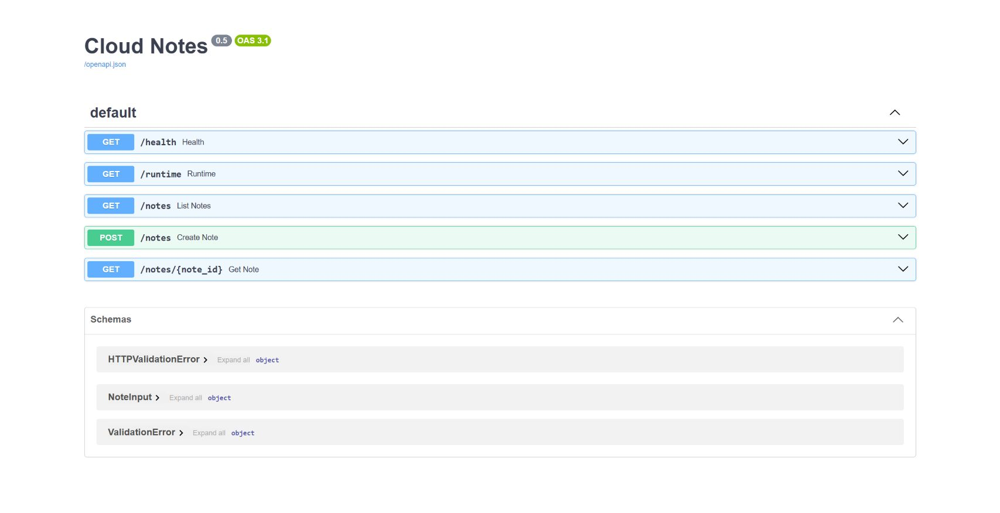

# Praktikum lokal Docker Core dan Docker Compose

**Cloud Services COMP6991031 | Kamis, 22 Oktober 2026 | Paskal 0801**

| Kelas | Waktu | Durasi |
|---|---|---|
| BA75 | 13:20-15:00 | 100 menit |
| BB75 | 15:20-17:00 | 100 menit |

Gunakan **Windows, Docker Desktop, VS Code, dan PowerShell**. Semua container berjalan di komputer sendiri. Python, PostgreSQL, dan Redis tidak perlu dipasang langsung di Windows. Internet dipakai untuk clone dan download image/dependency; setelah tersedia, stack berjalan lokal. Subtopik Docker Hub memerlukan akun dan Internet karena registry berada di luar komputer.

**Urutan kelas:** Docker Core 40 menit, Docker Compose 50 menit, pemeriksaan hasil dan penutupan 10 menit. Clone, download image, build pertama, serta penyiapan akun Docker Hub dikerjakan sebelum kelas. Praktik push pada bagian akhir dapat dilanjutkan sesudah sesi gabungan.

**Kebijakan kelas:** latihan formatif untuk satu proyek kelompok 3 orang. Presentasi checkpoint minggu 7 dan hasil akhir minggu 14 mengikuti kebijakan kelas/RPS. Tidak ada tugas, penyerahan, atau nilai tambahan dari modul ini.

## Subtopik yang dipelajari

| Sesi RPS | Subtopik | Praktik di modul |
|---|---|---|
| Docker Core | Dockerfile pertama untuk aplikasi Python | Menulis/membaca Dockerfile.single |
| Docker Core | Build dan tag image | docker build -t dan docker image ls |
| Docker Core | Menjalankan image dengan environment | docker run -e APP_ENV dan port mapping |
| Docker Core | Multi-stage builder dan runtime | Dua FROM dan COPY --from=builder |
| Docker Core | .dockerignore dan Docker Hub | Memilih build context, tag, login, push |
| Docker Compose | Stack web/API + DB + cache | Service api, db, cache |
| Docker Compose | Networking melalui nama service | DNS db dan cache dari container API |
| Docker Compose | Named volume | Catatan tetap ada setelah down/up |
| Docker Compose | Environment melalui .env | Satu file konfigurasi lokal |
| Docker Compose | Profile dan log streaming | Profile debug dan logs -f |

Tidak ada script instalasi tambahan yang dijalankan pada jalur praktik ini. Jalankan setiap baris perintah secara berurutan dari root repo. Gunakan blok kode GitHub untuk menyalin perintah panjang dari PDF.

## 0. Persiapan komputer dan folder

### 0.1 Periksa Docker Desktop

Buka Docker Desktop dan tunggu tulisan **Engine running**. Buka PowerShell, lalu jalankan:

```powershell
git --version
docker version
docker compose version
docker info --format '{{.OSType}}'
```

**Fungsi:** memastikan Git, Docker client/server, dan Compose tersedia. **Hasil:** docker version menampilkan bagian Client dan Server; OSType adalah linux. Perintah build memerlukan Docker Engine yang sudah berjalan. Instalasi Docker Desktop dapat mengikuti [petunjuk resmi Windows](https://docs.docker.com/desktop/setup/install/windows-install/).

### 0.2 Clone ke folder baru

Buka PowerShell pada folder kerja pilihan sendiri. Gunakan nama folder baru berikut agar file percobaan lama tidak tercampur:

```powershell
git clone https://github.com/SeedFlora/meet6CloudService.git meet6CloudService-local
cd .\meet6CloudService-local
Get-Location
Get-Item .\compose.yaml
```

**Hasil:** lokasi terminal berakhir dengan meet6CloudService-local dan file compose.yaml ditemukan. Di VS Code pilih **File > Open Folder > meet6CloudService-local**, lalu **Terminal > New Terminal** dan pilih PowerShell. Folder ini langsung berisi api, gabungan22, dan compose.yaml. Seluruh perintah berikut dijalankan dari folder ini.

### 0.3 Siapkan satu file .env

Untuk clone baru, salin contoh yang sudah disediakan:

```powershell
Copy-Item .\.env.example .\.env
docker compose config --quiet
```

**Fungsi:** membuat konfigurasi lokal untuk API dan PostgreSQL. **Hasil:** config --quiet selesai tanpa pesan error. Compose menolak konfigurasi saat password wajib belum diisi. File .env diabaikan Git. Tidak perlu membuat atau menyalin file di folder secrets.

| Isi .env contoh | Dipakai untuk |
|---|---|
| APP_ENV=classroom | Label lingkungan API |
| POSTGRES_DB=cloudnotes | Nama database |
| POSTGRES_USER=clouduser | Pengguna database |
| POSTGRES_PASSWORD | Password latihan lokal untuk DB dan API |

Password contoh hanya untuk data latihan di komputer sendiri. Pada pengulangan latihan, gunakan .env yang sudah benar; langkah copy di atas adalah penyiapan clone baru. PostgreSQL yang sudah berisi data mempertahankan password awalnya. [Panduan pindah dari modul lama](MIGRASI_MODUL_LAMA.md) menjelaskan pemakaian volume lama.

### 0.4 Download sebelum kelas

```powershell
docker pull python:3.12-slim
docker compose pull db cache adminer
docker compose build api
```

**Fungsi:** menyiapkan base image, database, cache, dan API. **Hasil:** download/build selesai. Waktu download bergantung jaringan. Docker Hub push memerlukan akun sendiri; login dilakukan oleh pemilik akun.

## A. Docker Core - 40 menit

### A1. Dockerfile pertama

Di Explorer VS Code, buka folder gabungan22/core; terminal tetap di root repo. Source Python sudah tersedia di app/main.py; requirements.txt memuat dependency. Buat atau buka **Dockerfile.single** tanpa tambahan ekstensi .txt. Ketik/ikuti isi berikut dan simpan:

```dockerfile
FROM python:3.12-slim
WORKDIR /app
COPY requirements.txt .
RUN pip install --no-cache-dir -r requirements.txt
COPY app ./app
ENV APP_ENV=classroom
EXPOSE 8000
CMD ["uvicorn", "app.main:app", "--host", "0.0.0.0", "--port", "8000"]
```

| Instruksi | Fungsi |
|---|---|
| FROM | Memilih base image Python |
| WORKDIR | Menetapkan folder kerja dalam image |
| COPY | Menyalin file dari build context |
| RUN | Menjalankan proses saat build, di sini memasang dependency |
| ENV | Menetapkan environment default |
| EXPOSE | Mendokumentasikan port container; belum membuka port Windows |
| CMD | Perintah default ketika container dijalankan |

COPY cukup untuk file proyek ini. ADD memiliki kemampuan tambahan seperti ekstraksi arsip tar lokal; gunakan COPY saat hanya menyalin file. ENTRYPOINT menetapkan program utama container, sementara CMD dapat menyediakan perintah/default argument; contoh ini memakai CMD untuk menjalankan Uvicorn. [Referensi Dockerfile](https://docs.docker.com/reference/dockerfile/)

### A2. Build image dan tag

Dari root repo:

```powershell
docker build -f .\gabungan22\core\Dockerfile.single -t cloud-notes-api:core-single .\gabungan22\core
docker image ls cloud-notes-api
```

**Fungsi:** membangun image dari Dockerfile.single. **Proses:** Docker mengambil file dalam context gabungan22/core, menjalankan instruksi, lalu memberi nama cloud-notes-api dengan tag core-single. **Hasil:** image muncul pada daftar. Tag adalah nama versi yang dapat dipindah ke image lain; image ID mengidentifikasi image lokal. Build belum menjalankan server API.

### A3. Multi-stage: builder dan runtime

Buka gabungan22/core/Dockerfile. File ini berisi dua tahap. Tahap builder memasang dependency ke /opt/venv; tahap runtime menyalin environment tersebut dan source aplikasi. Runtime menjalankan aplikasi sebagai appuser.

```dockerfile
FROM python:3.12-slim AS builder
WORKDIR /build
COPY requirements.txt .
RUN python -m venv /opt/venv && /opt/venv/bin/pip install --no-cache-dir -r requirements.txt

FROM python:3.12-slim AS runtime
ENV PATH="/opt/venv/bin:$PATH" PYTHONDONTWRITEBYTECODE=1 PYTHONUNBUFFERED=1
RUN useradd --create-home --uid 10001 appuser
WORKDIR /app
COPY --from=builder /opt/venv /opt/venv
COPY app ./app
USER appuser
EXPOSE 8000
CMD ["uvicorn", "app.main:app", "--host", "0.0.0.0", "--port", "8000"]
```

File lengkap sudah ada di repo. Bangun dari Dockerfile default:

```powershell
docker build -t cloud-notes-api:core22 .\gabungan22\core
docker image ls cloud-notes-api
docker run --rm cloud-notes-api:core22 id
```

**Hasil:** tag core22 tersedia dan id menunjukkan uid 10001. COPY --from=builder hanya menyalin hasil yang diperlukan ke runtime. Ukuran akhir harus diukur dari image yang terbentuk; dua tahap tidak otomatis menjamin image Python ini lebih kecil. --rm hanya menghapus container singkat yang dibuat oleh perintah id, bukan image.

### A4. Jalankan image dengan environment

```powershell
docker run --name cloudlab-core22 -d -p 127.0.0.1:18005:8000 -e APP_ENV=classroom cloud-notes-api:core22
docker ps --filter name=cloudlab-core22
docker logs cloudlab-core22
```

Tunggu log menampilkan **Application startup complete** dan Uvicorn berjalan pada port 8000. Setelah itu periksa HTTP:

```powershell
Invoke-RestMethod http://127.0.0.1:18005/health
Invoke-RestMethod http://127.0.0.1:18005/runtime
```

**Fungsi:** menjalankan image sebagai server API. **Proses:** port Windows 18005 diteruskan ke port container 8000; -e memasok environment ke proses aplikasi. **Hasil:** container Up; health menampilkan status ok dan service cloud-notes-api; runtime menampilkan environment classroom dan storage memory.

Buka **http://127.0.0.1:18005/docs**. Versi aplikasi adalah 0.5.



*Gambar UI:* daftar endpoint Core versi 0.5, diambil dari kode aplikasi revisi yang dijalankan melalui Python lokal. Gambar membantu mengenali antarmuka; kesiapan Docker tetap diperiksa dengan perintah di atas. Perhatikan endpoint /runtime dan POST /notes.

Gunakan Swagger:

1. Buka POST /notes, klik Try it out.
2. Isi JSON contoh berikut, lalu Execute.
3. Periksa status 201 dan id catatan.
4. Buka GET /notes, Try it out, Execute. Catatan tadi harus muncul.

```json
{"title":"Core lokal","content":"Data disimpan di memori proses"}
```

Core menyimpan catatan di memori proses. Restart proses mengosongkan data:

```powershell
docker restart cloudlab-core22
docker logs --tail 10 cloudlab-core22
```

Tunggu log startup terbaru menampilkan **Application startup complete**, lalu:

```powershell
Invoke-RestMethod http://127.0.0.1:18005/health
Invoke-RestMethod http://127.0.0.1:18005/notes
```

GET notes setelah restart menghasilkan daftar kosong; PowerShell dapat tidak menampilkan baris apa pun untuk array kosong. Swagger memperlihatkan [] secara eksplisit.

### A5. .dockerignore dan registry

Buka gabungan22/core/.dockerignore. Aturan ini mengecualikan file yang tidak dibutuhkan dari build context. .gitignore mengatur Git; .dockerignore mengatur file yang dikirim ke builder. Keduanya berbeda.

Image core22 saat ini hanya berada di komputer lokal. Docker Hub adalah registry untuk menyimpan dan membagikan image. Tag tujuan memakai format akun/repository:versi. [Bagian C](#c-docker-hub---subtopik-core) memuat langkah login, tag, dan push dari PowerShell lokal.

Selesaikan tahap Core:

```powershell
docker stop cloudlab-core22
docker rm cloudlab-core22
```

**Hasil:** container Core berhenti dan dihapus, sedangkan kedua image tetap ada. Tahap Compose memakai API berbeda di port Windows 18006.

## B. Docker Compose - 50 menit

### B1. Stack API, database, dan cache

Buka compose.yaml. Compose mengelola beberapa service pada satu Docker host.

| Bagian | Fungsi pada proyek |
|---|---|
| services.api | API Python dibangun dari folder api |
| services.db | PostgreSQL 16 menyimpan catatan |
| services.cache | Redis 7 menyimpan cache daftar catatan |
| environment | Mengirim konfigurasi dari .env ke container |
| ports | Membuka API di 127.0.0.1:18006 menuju container 8000 |
| volumes | Menyimpan data DB/cache di named volume |
| healthcheck | Memeriksa kesiapan service |
| depends_on | Menunggu DB/cache sehat sebelum API dimulai |
| profiles | Menyalakan Adminer hanya saat profile debug dipilih |

Compose otomatis membuat network default. DB dan Redis dapat diakses API di dalam network, tanpa membuka port database/cache di Windows. compose.yaml adalah nama file Compose yang dipakai repo ini; contoh docker-compose.yml pada RPS merujuk jenis konfigurasi yang sama.

```powershell
docker compose config --quiet
docker compose up --build -d --wait
docker compose ps
Invoke-RestMethod http://127.0.0.1:18006/health
```

**Hasil:** api, db, dan cache healthy. Health Compose harus memuat tiga nilai berikut:

```text
status    ok
database  postgres
cache     redis
```

API Compose berbeda dari Core: health-nya benar-benar memeriksa DB dan Redis. Halaman docs berada di **http://127.0.0.1:18006/docs**, versi aplikasi 0.6. Respons service cloud-notes-api saja adalah Core, sehingga belum membuktikan Compose sehat.


*Gambar UI:* endpoint API Compose versi 0.6, diambil dari kode aplikasi revisi yang dijalankan melalui Python lokal. Ini contoh antarmuka, bukan bukti tiga container/DB berjalan. Kesiapan stack diperiksa melalui ps dan health. Versi ini memiliki DELETE /notes/{note_id} dan tidak memiliki /runtime.

### B2. Networking melalui nama service

```powershell
docker compose exec -T api getent hosts db cache
```

**Fungsi:** memeriksa resolusi nama service di dalam container API. **Hasil:** db dan cache memiliki alamat IP internal. IP dapat berubah setelah container dibuat ulang. Hostname service tetap digunakan oleh aplikasi. localhost di container API menunjuk container API sendiri, sehingga koneksi DB menggunakan db, bukan localhost.

### B3. Named volume dan data persisten

Buka Swagger Compose port 18006. Pada POST /notes, klik Try it out, masukkan JSON, lalu Execute:

```json
{"title":"Compose lokal","content":"Data disimpan di PostgreSQL"}
```

**Hasil:** status 201, id, title, content, dan created_at. Catat id/title yang benar-benar didapat; database yang pernah dipakai tidak harus mulai dari id 1. GET /notes harus memperlihatkan catatan tersebut.

Lihat baris database:

```powershell
docker compose exec -T db psql -U clouduser -d cloudnotes -c "SELECT id, title FROM notes ORDER BY id;"
docker volume ls --filter name=cloud-notes-lab06
```

**Fungsi:** menghubungkan hasil API dengan data PostgreSQL dan named volume. **Hasil:** id/title cocok. Volume db_data menyimpan file DB di luar umur container.

Uji persistensi:

```powershell
docker compose down
docker compose up -d --wait
Invoke-RestMethod http://127.0.0.1:18006/notes
```

**Hasil:** catatan dengan id/title tadi masih ada walaupun container diganti. down menghentikan container dan menghapus network project, sambil mempertahankan named volume. Perintah latihan tidak memakai penghapusan volume.

Cache adalah bagian dari stack. Lakukan GET dua kali berurutan dalam waktu kurang dari 30 detik:

```powershell
curl.exe -i http://127.0.0.1:18006/notes
curl.exe -i http://127.0.0.1:18006/notes
```

Header X-Cache dapat berubah dari MISS menjadi HIT: MISS membaca PostgreSQL dan mengisi Redis; HIT membaca salinan cache. Catatan baru yang dikirim lewat POST menghapus cache daftar. GET yang sudah dilakukan Swagger/anggota lain dapat membuat panggilan pertama langsung HIT. Data tetap bersumber dari PostgreSQL.

### B4. Environment melalui .env

Buka .env di VS Code. Ubah hanya APP_ENV dari classroom menjadi local-demo, lalu simpan. Nilai DB dan password tetap sama.

```powershell
docker compose up -d --wait api
docker compose exec -T api printenv APP_ENV
```

**Hasil:** local-demo. Compose membaca .env untuk mengisi environment pada compose.yaml. Perubahan konfigurasi diterapkan dengan up, bukan hanya restart proses. Kembalikan APP_ENV menjadi classroom, simpan, dan jalankan:

```powershell
docker compose up -d --wait api
docker compose exec -T api printenv APP_ENV
```

**Hasil:** classroom. API dan DB mendapatkan password yang sama dari konfigurasi lokal. Password tidak perlu diketik pada perintah terminal atau ditaruh di source Python.

### B5. Profile dan log streaming

```powershell
docker compose --profile debug up -d adminer
docker compose ps
```

**Fungsi:** menyalakan alat admin database melalui profile debug. **Hasil:** Adminer berjalan di **http://127.0.0.1:18061**. Profile mengelompokkan service tambahan; api, db, cache tetap layanan utama. Pada contoh ini profile bernama debug. Penamaan dev/staging/production dapat dipakai pada proyek lain, sesuai service yang diperlukan.

Buka Adminer dan isi:

| Kolom | Nilai latihan |
|---|---|
| System | PostgreSQL |
| Server | db |
| Username | clouduser |
| Password | Nilai POSTGRES_PASSWORD pada .env lokal |
| Database | cloudnotes |

Klik Login, pilih tabel notes, lalu Select data. Cocokkan id/title dengan Swagger. Adminer memakai hostname db karena berjalan di network yang sama.

Buka **terminal PowerShell kedua** pada root repo, lalu:

```powershell
docker compose logs -f --tail 20 api
```

Di browser panggil GET /notes melalui Swagger. **Hasil:** baris request masuk terlihat pada log API. Tekan **Ctrl+C** pada terminal log untuk berhenti mengikuti log; container tetap berjalan.

## Pemeriksaan hasil dan penutupan - 10 menit

| Pemeriksaan | Hasil yang benar |
|---|---|
| Build | Tag core-single dan core22 tersedia |
| Multi-stage | Builder memasang dependency; runtime menyalin hasilnya |
| Core | API 0.5 di port 18005, environment classroom, storage memory |
| Compose | API 0.6 di port 18006, health memuat postgres dan redis |
| DNS | db/cache dapat di-resolve dari API |
| Persistensi | id/title tetap ada setelah down/up |
| .env | APP_ENV dapat diubah dan dikembalikan |
| Profile/log | Adminer berjalan pada profile debug dan request terlihat di log |

Tutup latihan dengan perintah berikut dari root repo:

```powershell
docker compose --profile debug down
docker compose ps -a
```

**Hasil:** container project berhenti; volume database dan image tetap tersimpan. Untuk melanjutkan pada komputer yang sama, jalankan docker compose up -d --wait, lalu buka port 18006.

## C. Docker Hub - subtopik Core

Bagian ini menjalankan CLI pada komputer lokal, dengan Docker Hub sebagai registry online. Siapkan akun sendiri sebelum praktik. Buka hub.docker.com, buat repository cloud-notes-api di akun sendiri. Login dilakukan sendiri melalui alur yang ditampilkan Docker.

```powershell
docker login
```

Pada tiga baris berikut, **ganti dockerid dengan username Docker Hub sendiri**, gunakan huruf kecil yang sesuai akun. Perintah ini menerbitkan image latihan ke repository yang dibuat sendiri:

```powershell
docker tag cloud-notes-api:core22 dockerid/cloud-notes-api:1.0
docker push dockerid/cloud-notes-api:1.0
docker pull dockerid/cloud-notes-api:1.0
```

**Fungsi:** tag memberi nama tujuan registry; push mengunggah layer/manifest; pull mengambil image dari registry. **Hasil:** push selesai dengan digest dan tag 1.0 terlihat di repository sendiri. Pull menunjukkan image terbaru atau layer yang sudah ada. Tag bukan upload; build juga bukan push. Akun/Internet diperlukan untuk menyelesaikan subtopik ini. Langkah tersebut tidak diperlukan untuk menyalakan stack Compose lokal.

## Mengatasi error yang berkaitan dengan praktik

| Gejala | Tindakan langsung |
|---|---|
| Docker hanya menampilkan Client | Buka Docker Desktop, tunggu Engine running, ulangi docker version. |
| compose.yaml tidak ditemukan | Buka root meet6CloudService-local, bukan folder induk atau api. |
| Diminta mengisi POSTGRES_PASSWORD | Siapkan .env dari .env.example pada clone baru; pastikan field password terisi. |
| Masih membaca secrets/db_password.txt | Yang dijalankan adalah konfigurasi lama. Gunakan clone baru dan compose.yaml revisi ini. |
| Nama cloudlab-core22 sudah ada | Lihat docker ps -a --filter name=cloudlab-core22, hentikan dan hapus container latihan sendiri itu, lalu ulangi run. |
| Port 18005/18006 dipakai | Lihat docker ps, hentikan container latihan sendiri yang memakai port tersebut sebelum memulai ulang. |
| /health hanya berisi service cloud-notes-api | Buka Compose pada port 18006; port 18005 dipakai Core. |
| DB login gagal setelah password diganti | Database lama mempertahankan password awal. Gunakan password awal yang sesuai; lihat panduan migrasi. |
| api belum berjalan | Baca docker compose logs --tail 30 db api cache, selesaikan error service pertama, lalu up --build -d --wait lagi. |
| Image Hub ditolak | Cocokkan username login, nama repository sendiri, dan tag tujuan. |

## Rujukan

- [Dockerfile](https://docs.docker.com/reference/dockerfile/), [build context dan .dockerignore](https://docs.docker.com/build/concepts/context/), [multi-stage](https://docs.docker.com/build/building/multi-stage/).
- [Tag/push image](https://docs.docker.com/get-started/introduction/build-and-push-first-image/).
- [Compose startup order](https://docs.docker.com/compose/how-tos/startup-order/), [networking](https://docs.docker.com/compose/how-tos/networking/), [volumes](https://docs.docker.com/engine/storage/volumes/), [.env](https://docs.docker.com/compose/how-tos/environment-variables/variable-interpolation/), [profiles](https://docs.docker.com/compose/how-tos/profiles/).
- API Core berasal dari materi Lab 05 dengan lisensi MIT di gabungan22/core/LICENSE. API Compose terdapat di api/app/main.py. Screenshot lama memakai konfigurasi/port terdahulu dan tidak dijadikan petunjuk perintah revisi ini.
