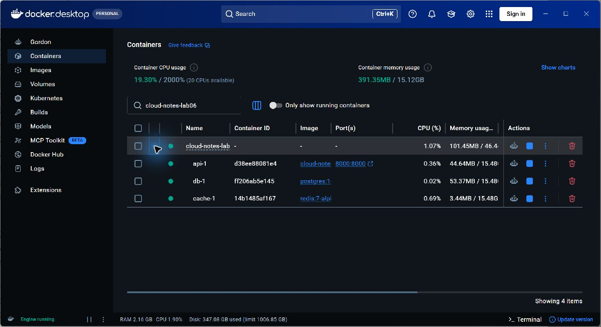
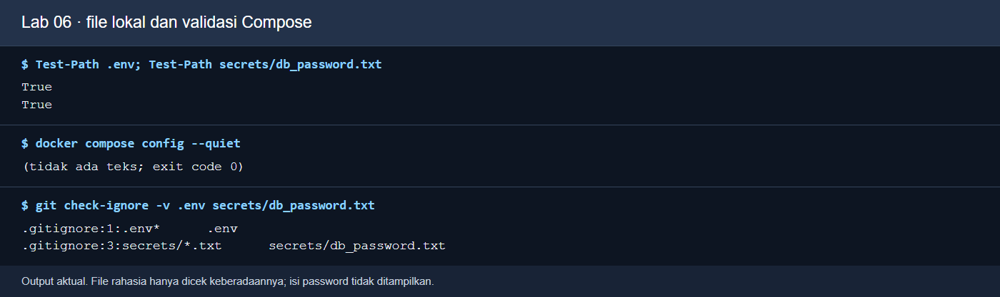
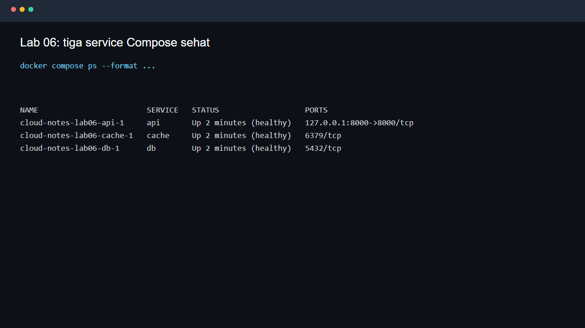
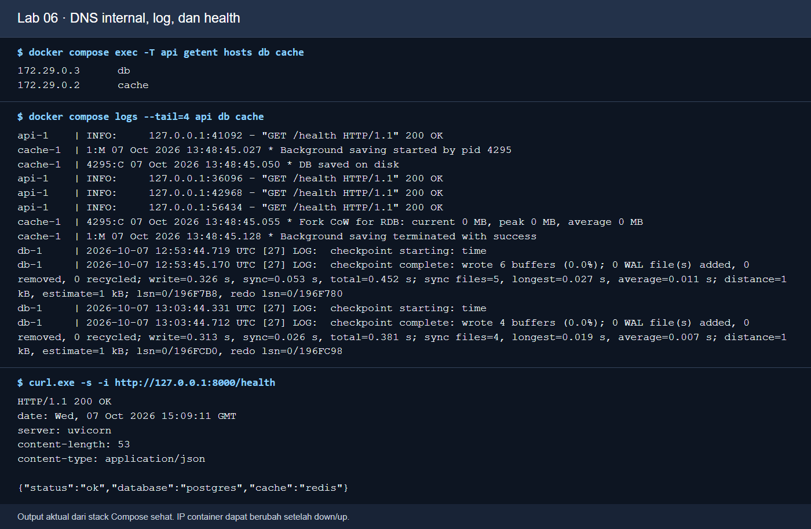
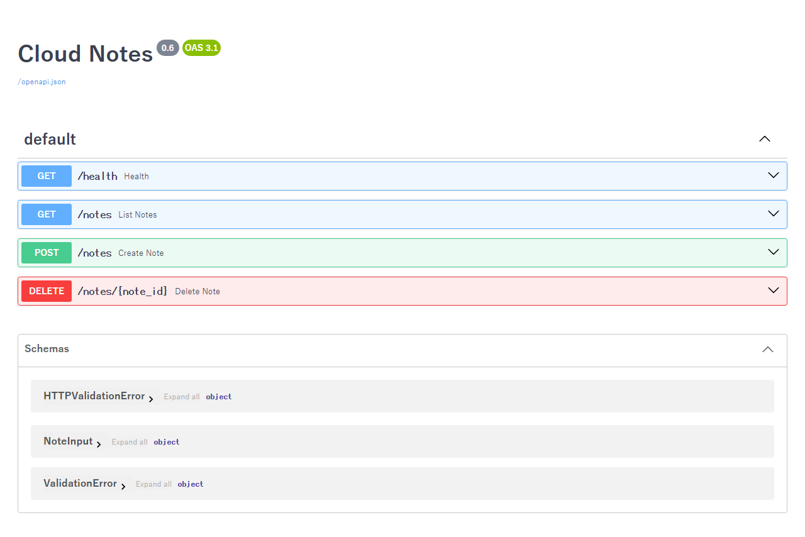
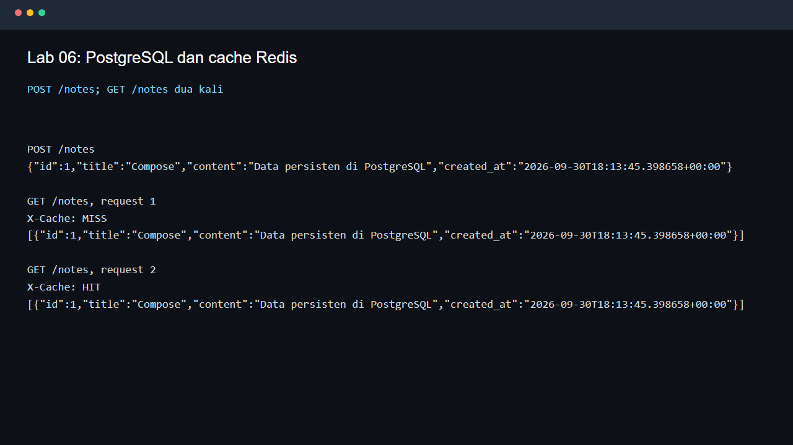
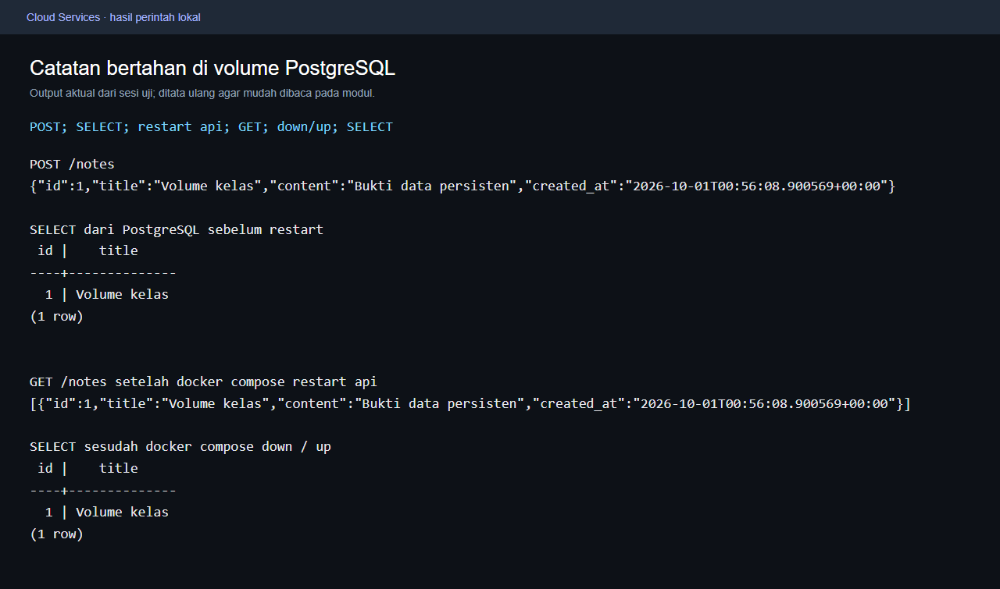
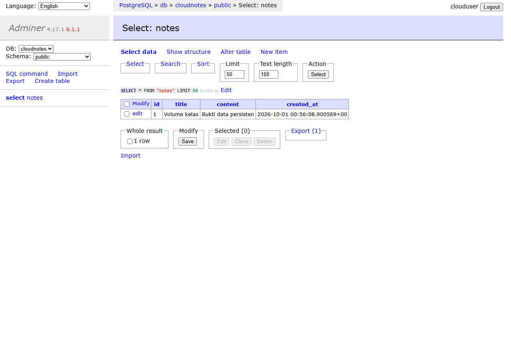
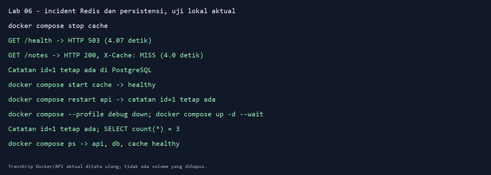

# Teori Docker Compose dan Bukti Lab 06

Materi Pertemuan 06 menghubungkan teori layanan cloud dengan aplikasi Cloud Notes yang sudah tersedia dalam repo ini. Baca [slide teori](slides/Teori_Pertemuan_06.pptx), ikuti panduan ini, lalu gunakan [modul praktikum](MODUL_MAHASISWA.md) untuk latihan dan kunci analisis. [Versi PDF panduan teori](TEORI_LANGKAH_DEMI_LANGKAH.pdf) tersedia untuk dibaca atau dicetak.

**Kebijakan kelas:** Lab 06 merupakan latihan formatif untuk satu proyek kelompok 3 orang. Presentasi checkpoint berlangsung pada minggu 7 dan hasil akhir pada minggu 14. Bobot mengikuti RPS/LMS. Checkpoint di bawah membantu Anda menguji pemahaman dan tidak menambah tugas atau nilai terpisah.

## Urutan belajar

| Tahap | Konsep dalam slide | Bukti yang diamati |
|---|---|---|
| 1-3 | Service, Dockerfile, healthcheck, startup | Konfigurasi valid, tiga service sehat, HTTP 200 |
| 4-5 | DNS internal, port host, request API | Nama db/cache dari container dan Swagger dari browser |
| 6-7 | Database, cache, named volume | MISS/HIT dan catatan tetap ada sesudah container diganti |
| 8 | Profile debug | Adminer terhubung ke database yang sama |
| 9 | Kegagalan dependency | Health 503, data tetap dapat dibaca, pemulihan Redis |
| 10 | Backup dan restore | Arsip PostgreSQL dan data pada database uji baru |
| 11-12 | Replica, shutdown, Git | Batas port tetap, stack berhenti, secret tetap lokal |

Jalur wajib menggunakan Docker Desktop/Engine lokal dan Compose plugin. Tidak memerlukan akun layanan berbayar. Docker Compose menjalankan stack pada satu Docker host. Deployment publik memerlukan rancangan layanan, jaringan, dan pengelolaan secret tersendiri.

Screenshot di panduan ini berasal dari bukti yang sudah tersedia pada modul Lab 06. Gambar terminal berlabel **render transkrip** menata output command aktual agar terbaca. Gambar browser berasal dari UI layanan yang dijalankan. IP, ID, waktu, versi, dan jumlah catatan dapat berbeda pada hasil Anda. Gambar pada modul merupakan contoh, sehingga gunakan hasil sendiri untuk memeriksa pekerjaan Anda.

## 0. Mengambil repo dan memeriksa Docker

Jalankan di folder kerja pilihan Anda. Gunakan nama folder baru jika `meet6CloudService` sudah ada. PowerShell:

```powershell
git clone https://github.com/SeedFlora/meet6CloudService.git meet6CloudService
Set-Location -LiteralPath .\meet6CloudService
Get-Item -LiteralPath .\compose.yaml
docker version
docker compose version
```

Bash/WSL:

```bash
git clone https://github.com/SeedFlora/meet6CloudService.git meet6CloudService
cd "./meet6CloudService"
ls -l compose.yaml
docker version
docker compose version
```

Pada Windows, jalankan Docker Desktop dan tunggu engine siap. **Hasil:** `docker version` menampilkan bagian Client dan Server, serta `docker compose version` menampilkan versi plugin. Pesan tidak dapat menghubungi daemon berarti engine belum siap. Tunggu atau periksa Docker Desktop sebelum lanjut. Jika Git belum tersedia, pasang Git terlebih dahulu atau gunakan unduhan ZIP repo dan buka root hasil ekstraknya.

## 1. Membaca service dan aliran data

Buka [`compose.yaml`](compose.yaml). Project bernama `cloud-notes-lab06`. Service `api` menjalankan FastAPI, `db` menjalankan PostgreSQL 16, dan `cache` menjalankan Redis 7. Service `adminer` hanya aktif saat profile `debug` digunakan.

Browser mengirim HTTP ke `127.0.0.1:8000`, lalu Docker meneruskan request ke port 8000 container API. API membaca PostgreSQL melalui hostname `db` dan menghubungi Redis melalui hostname `cache`. Browser host tidak memakai nama DNS internal tersebut. PostgreSQL dan Redis tidak memiliki mapping port ke host pada konfigurasi utama.

Buka [`api/Dockerfile`](api/Dockerfile). Builder memasang dependency ke `/opt/venv`. Runtime menyalin environment Python dan source, lalu menjalankan API sebagai UID 10001. Image berisi aplikasi dan dependency, sedangkan container menjalankan prosesnya. Ukuran image harus diukur dari hasil build yang dipakai, karena tag, arsitektur, dan dependency memengaruhinya.



**Langkah:** baca service di YAML dan cocokkan dengan nama service pada Docker Desktop setelah tahap startup. **Fungsi:** memahami proses mana yang mengerjakan request. **Cara kerja:** Compose membuat container untuk service yang aktif. **Hasil:** API, PostgreSQL, dan Redis berjalan dalam project yang sama. Titik hijau menunjukkan proses berjalan; gunakan `docker compose ps` untuk membaca healthcheck. **Jenis bukti:** tangkapan UI Docker Desktop dari uji sebelumnya.

## 2. Menyiapkan terminal, konfigurasi, dan secret

Clone/download repo ini ke folder lokal, buka terminal di root repo, dan pastikan Docker berjalan. Root yang benar memuat `compose.yaml`, folder `api`, `initdb`, dan `secrets`. Hentikan container latihan Lab 05 bila port 8000 masih dipakai. Simpan file lokal yang sudah ada sebelum menggantinya.

PowerShell, untuk file yang belum tersedia:

```powershell
if (-not (Test-Path .\secrets\db_password.txt)) { Copy-Item .\secrets\db_password.txt.example .\secrets\db_password.txt }
if (-not (Test-Path .\.env)) { Copy-Item .\.env.example .\.env }
docker version
docker compose version
docker compose config --quiet
git check-ignore -v .env secrets/db_password.txt
```

Bash/WSL, untuk file yang belum tersedia:

```bash
test -f secrets/db_password.txt || cp secrets/db_password.txt.example secrets/db_password.txt
test -f .env || cp .env.example .env
docker version
docker compose version
docker compose config --quiet
git check-ignore -v .env secrets/db_password.txt
```



**Langkah:** siapkan file lokal, jalankan validasi, lalu periksa aturan Git. **Fungsi:** menemukan kesalahan YAML sebelum startup dan menjaga password tetap lokal. **Cara kerja:** `config --quiet` memvalidasi konfigurasi tanpa mencetak isi secret. `check-ignore` menunjukkan aturan yang mengabaikan file. **Hasil:** konfigurasi selesai dengan exit code 0, sedangkan `.env` dan `secrets/db_password.txt` memiliki aturan `.gitignore`. **Jenis bukti:** render transkrip output command aktual dari uji sebelumnya.

Compose memasang secret sebagai file `/run/secrets/db_password` pada DB dan API. Path file bukan nilai password. Secret berbasis file pada Compose lokal tetap berada di host dan memerlukan perlindungan akses. Ganti password contoh sebelum memakai proyek di luar latihan. Jika database sudah diinisialisasi pada volume lama, mengganti file password saja tidak mengganti password database yang tersimpan.

## 3. Startup dan arti healthcheck

Command berikut sama pada PowerShell dan Bash. Jalankan dari root repo:

```bash
docker compose up --build -d --wait
docker compose ps
docker compose logs --tail=30 api db cache
```



**Langkah:** start stack, tunggu, lalu baca status dan log. **Fungsi:** membuktikan kesiapan layanan sebelum mengirim request. **Cara kerja:** `--build` membangun image API, `-d` menjalankan container di belakang layar, dan `--wait` menunggu status running/healthy sesuai konfigurasi. API memakai `depends_on: service_healthy` untuk DB dan cache. **Hasil:** `api`, `db`, dan `cache` sehat. **Jenis bukti:** output terminal stack lokal pada uji sebelumnya.

Healthcheck DB menjalankan `pg_isready`, Redis menjalankan `redis-cli ping`, dan API memanggil `/health`. Bentuk pendek `depends_on: [db]` mengatur urutan startup tanpa menunggu healthcheck DB. Status sehat saat startup tetap perlu dipantau saat aplikasi berjalan.

## 4. DNS internal, log, dan koneksi HTTP

```bash
docker compose exec -T api getent hosts db cache
docker compose port api 8000
```

PowerShell:

```powershell
Invoke-RestMethod http://127.0.0.1:8000/health
```

Bash/WSL:

```bash
curl -fsS http://127.0.0.1:8000/health
```



**Langkah:** jalankan lookup dari dalam container API, lalu uji HTTP dari host. **Fungsi:** memisahkan jalur jaringan internal dengan akses browser. **Cara kerja:** DNS Docker menyelesaikan `db` dan `cache` pada network bersama. Mapping port memberi akses host ke API. **Hasil:** kedua hostname menghasilkan alamat, port API terpetakan, dan `/health` memberi HTTP 200 dengan `status=ok`, `database=postgres`, serta `cache=redis`. **Jenis bukti:** render transkrip output command aktual. Alamat IP dapat berubah.

Untuk mengikuti log, buka terminal kedua dan jalankan `docker compose logs -f api`. Ctrl+C menghentikan tampilan log. Container tetap berjalan. `docker compose logs api` tanpa `-f` hanya membaca log yang tersimpan.

## 5. Swagger dan validasi request

Buka `http://127.0.0.1:8000/docs`. Pilih GET `/health`, klik **Try it out**, lalu **Execute**. Baca status HTTP dan body respons. Selanjutnya pilih POST `/notes`, isi JSON dummy berikut, dan jalankan:

```json
{"title":"Compose","content":"Catatan latihan di PostgreSQL"}
```



**Langkah:** panggil GET health, POST catatan, dan GET notes melalui Swagger. **Fungsi:** memahami bahwa container yang hidup perlu diuji perilaku aplikasinya. **Cara kerja:** Swagger mengirim HTTP ke endpoint yang sama dengan curl atau PowerShell. [`api/app/main.py`](api/app/main.py) memvalidasi input sebelum mengakses database. **Hasil:** health 200, POST valid 201, dan catatan muncul pada GET notes. Input yang tidak memenuhi model memberi 422. **Jenis bukti:** tangkapan browser Swagger API yang berjalan pada uji sebelumnya.

## 6. PostgreSQL sebagai sumber data dan Redis sebagai cache

PowerShell:

```powershell
$body = '{"title":"Compose","content":"Data tetap ada di PostgreSQL"}'
Invoke-RestMethod http://127.0.0.1:8000/notes -Method Post -ContentType application/json -Body $body
(Invoke-WebRequest http://127.0.0.1:8000/notes -UseBasicParsing).Headers['X-Cache']
(Invoke-WebRequest http://127.0.0.1:8000/notes -UseBasicParsing).Headers['X-Cache']
```

Bash/WSL:

```bash
curl -fsS -X POST http://127.0.0.1:8000/notes -H 'Content-Type: application/json' -d '{"title":"Compose","content":"Data tetap ada di PostgreSQL"}'
curl -i http://127.0.0.1:8000/notes
curl -i http://127.0.0.1:8000/notes
```



**Langkah:** buat satu catatan, lalu lakukan dua GET dengan cepat. **Fungsi:** mengamati cache melalui respons API. **Cara kerja:** POST menghapus cache daftar. GET pertama membaca DB dan mengisi Redis. GET berikutnya membaca cache selama TTL 30 detik. **Hasil:** `X-Cache: MISS`, lalu `X-Cache: HIT` dengan isi catatan yang sama. **Jenis bukti:** output HTTP aktual pada uji sebelumnya. Jika jeda melebihi TTL, ulangi dua GET berturut-turut.

## 7. Named volume dan persistensi

Jalankan command berikut pada PowerShell atau Bash:

```bash
docker compose exec -T db psql -U clouduser -d cloudnotes -c 'SELECT id, title FROM notes;'
docker compose restart api
docker compose ps
```

Tunggu API sehat, lalu panggil GET notes dengan cara di tahap sebelumnya. Selanjutnya uji penggantian container:

```bash
docker compose --profile debug down
docker compose up -d --wait
docker compose exec -T db psql -U clouduser -d cloudnotes -c 'SELECT id, title FROM notes;'
```



**Langkah:** bandingkan ID/judul catatan sebelum dan sesudah restart API serta down/up. **Fungsi:** membuktikan tempat data disimpan. **Cara kerja:** PostgreSQL menulis ke named volume `db_data`, terpisah dari lifecycle container. `down` menghapus container/network project tetapi mempertahankan named volume. **Hasil:** catatan tetap ada. **Jenis bukti:** output command aktual yang sudah tersedia di modul. `down -v` menghapus named volume project dan hanya relevan jika seluruh data latihan boleh hilang.

## 8. Profile debug dan Adminer

```bash
docker compose --profile debug up -d adminer
```

Buka `http://127.0.0.1:8081`. Pilih sistem PostgreSQL, server `db`, pengguna `clouduser`, database `cloudnotes`, dan password dari file lokal. Setelah login, pilih tabel `notes`, lalu **Select data**.



**Langkah:** aktifkan profile, login, dan baca tabel yang sama. **Fungsi:** membandingkan isi database dengan GET notes. **Cara kerja:** Adminer menjadi service tambahan pada network Compose dan mengirim query SQL ke DB. **Hasil:** ID/judul sama dengan data API. **Jenis bukti:** tangkapan UI Adminer dari uji sebelumnya. Simpan screenshot setelah login agar password tidak terlihat. Hindari tombol Drop/Truncate.

## 9. Cache berhenti dan pemulihan

```bash
docker compose stop cache
docker compose ps
docker compose logs --tail=20 api cache
```

Bash/WSL: jalankan `curl -i http://127.0.0.1:8000/health` dan `curl -i http://127.0.0.1:8000/notes`. PowerShell: gunakan command penanganan respons 503 pada [kunci tantangan modul](MODUL_MAHASISWA.md#kunci-tantangan-cache-redis-berhenti-saat-layanan-dipakai).



**Langkah:** matikan cache latihan, amati health dan GET notes, lalu pulihkan. **Fungsi:** membedakan kegagalan dependency dari kehilangan data. **Cara kerja:** health memeriksa Redis sehingga menjadi 503. GET notes memakai PostgreSQL ketika akses cache gagal. **Hasil:** GET notes tetap 200/MISS dan data masih ada, meskipun request dapat melambat. **Jenis bukti:** render transkrip pengujian aktual yang tersedia pada modul. Waktu respons bergantung kondisi uji.

```bash
docker compose start cache
docker compose up -d --wait
docker compose ps
```

Ulangi GET health dan dua GET notes. Health kembali 200 dan pola MISS/HIT kembali terlihat. Readiness saat startup dan ketahanan aplikasi saat runtime merupakan dua hal yang perlu diperiksa.

## 10. Backup logis dan restore ke database uji baru

Tahap tambahan ini menggunakan PostgreSQL 16 pada service `db` yang sehat. `pg_dump` membuat snapshot konsisten satu database ketika aplikasi berjalan. Arsip ini tidak mencadangkan Redis, semua database dalam cluster, atau konfigurasi layanan. Gunakan data dummy, jaga file backup tetap lokal, dan baca setiap pesan gagal sebelum melanjutkan. Tahap ini belum memiliki screenshot hasil baru; bukti Anda adalah daftar isi arsip dan hasil SELECT pada database uji.

PowerShell, satu command per baris:

```powershell
New-Item -ItemType Directory -Force .\backups | Out-Null
docker compose exec -T db pg_dump -U clouduser -d cloudnotes -Fc -f /tmp/cloudnotes.dump
$LASTEXITCODE
docker compose cp db:/tmp/cloudnotes.dump ".\backups\cloudnotes.dump"
$LASTEXITCODE
Get-Item -LiteralPath .\backups\cloudnotes.dump
docker compose exec -T db pg_restore -l /tmp/cloudnotes.dump
$LASTEXITCODE
docker compose exec -T db createdb -U clouduser cloudnotes_restore_check
$LASTEXITCODE
docker compose exec -T db pg_restore --exit-on-error -U clouduser -d cloudnotes_restore_check /tmp/cloudnotes.dump
$LASTEXITCODE
docker compose exec -T db psql -U clouduser -d cloudnotes_restore_check -c 'SELECT id, title FROM notes;'
docker compose exec -T db psql -U clouduser -d cloudnotes -c 'SELECT id, title FROM notes;'
```

Bash/WSL, satu command per baris:

```bash
mkdir -p "./backups"
docker compose exec -T db pg_dump -U clouduser -d cloudnotes -Fc -f /tmp/cloudnotes.dump
echo "$?"
docker compose cp db:/tmp/cloudnotes.dump "./backups/cloudnotes.dump"
echo "$?"
ls -l "./backups/cloudnotes.dump"
docker compose exec -T db pg_restore -l /tmp/cloudnotes.dump
echo "$?"
docker compose exec -T db createdb -U clouduser cloudnotes_restore_check
echo "$?"
docker compose exec -T db pg_restore --exit-on-error -U clouduser -d cloudnotes_restore_check /tmp/cloudnotes.dump
echo "$?"
docker compose exec -T db psql -U clouduser -d cloudnotes_restore_check -c 'SELECT id, title FROM notes;'
docker compose exec -T db psql -U clouduser -d cloudnotes -c 'SELECT id, title FROM notes;'
```

**Langkah:** dump, salin arsip, baca isi arsip, buat DB tujuan baru, restore, lalu bandingkan data. **Fungsi:** membuktikan bahwa file backup dapat digunakan. **Cara kerja:** `-Fc` memilih format arsip custom, `-f` menulis file biner di container, dan `docker compose cp` menyalin byte ke host tanpa mengubah encoding PowerShell. `pg_restore` membaca arsip tersebut ke DB baru. **Hasil:** exit code 0, file lokal berukuran lebih dari nol, daftar objek tampil, dan ID/judul pada sumber sama dengan database uji.

Jika exit code bukan 0, hentikan tahap berikutnya dan periksa pesan. Jika `cloudnotes_restore_check` sudah ada, pilih nama baru seperti `cloudnotes_restore_check_2` pada command `createdb`, `pg_restore`, dan SELECT. Jangan lanjut restore ke tujuan lama. Jangan gunakan `--clean`, `--create`, atau penghapusan volume untuk pengujian ini. Database `cloudnotes` dan named volume tetap ada.

Untuk memeriksa salinan host setelah container dibuat ulang, jalankan `docker compose cp "./backups/cloudnotes.dump" db:/tmp/cloudnotes_restore.dump`, lalu gunakan `/tmp/cloudnotes_restore.dump` pada `pg_restore -l` dan restore ke DB uji baru. Folder `backups/` dan file `*.dump` diabaikan Git agar isi database tidak ikut push.

## 11. Batas replica pada contoh kelas

Lab 06 memetakan API ke host port tetap `127.0.0.1:8000:8000`. Dua replica yang mencoba mapping sama akan berebut port. Karena itu, command `docker compose up -d --scale api=3` tidak dapat langsung diterapkan pada konfigurasi ini.

Untuk mempelajari replica pada contoh terpisah, hilangkan `container_name`, hindari publish host port tetap pada tiap replica API, dan publish satu pintu masuk pada proxy. Konfigurasi proxy perlu mengetahui upstream serta menangani perubahan alamat. DNS internal membantu menemukan alamat service; pembagian request bergantung perilaku client dan konfigurasi load balancer. Penambahan replica tetap perlu uji respons, session, cache, dan akses data bersama.

## 12. Shutdown, pengecekan Git, dan refleksi

Jika lanjut ke Lab 07, stack Lab 06 dapat dipertahankan sesuai modul. Setelah latihan selesai:

```bash
docker compose --profile debug down
docker compose ps
git status --short
git check-ignore -v .env secrets/db_password.txt
```

Command shutdown juga menghentikan Adminer jika profile debug aktif dan menjaga volume. `git status` membantu memeriksa file yang akan dibagikan. Jangan stage `.env`, password nyata, atau backup database. Ikuti [panduan Git](PANDUAN_GIT.md) untuk commit source dan konfigurasi contoh yang relevan bagi proyek.

Jawab berdasarkan bukti yang Anda lihat:

1. Mengapa `db` dapat digunakan API tetapi browser memakai `127.0.0.1`?
2. Apa bukti bahwa readiness dan proses yang hidup memberi informasi berbeda?
3. Mengapa restart API dan penggantian container tidak menghapus catatan?
4. Apa perbedaan kegagalan cache dengan kegagalan database pada implementasi ini?
5. Bukti apa yang diperlukan sebelum menganggap backup berhasil?

## Sumber resmi dan peta kode

- [Docker Compose CLI](https://docs.docker.com/reference/cli/docker/compose/) untuk command lengkap.
- [Startup order dan healthcheck](https://docs.docker.com/compose/how-tos/startup-order/) untuk `service_healthy`.
- [Networking Compose](https://docs.docker.com/compose/how-tos/networking/) untuk DNS dan port host.
- [Service specification](https://docs.docker.com/reference/compose-file/services/) untuk `container_name`, port, dan replica.
- [Compose secrets](https://docs.docker.com/compose/how-tos/use-secrets/) untuk akses file secret per service.
- [PostgreSQL 16 pg_dump](https://www.postgresql.org/docs/16/app-pgdump.html) dan [pg_restore](https://www.postgresql.org/docs/16/app-pgrestore.html) untuk backup logis.
- [Nginx upstream](https://nginx.org/en/docs/http/ngx_http_upstream_module.html) untuk konfigurasi proxy pada topik replica lanjutan.
- [`compose.yaml`](compose.yaml), [`api/Dockerfile`](api/Dockerfile), [`api/app/main.py`](api/app/main.py), dan [`initdb`](initdb/) merupakan sumber praktik pada repo ini.

Panduan diselaraskan dengan konfigurasi repo dan dokumentasi resmi yang diperiksa pada 15 Oktober 2026.
